# 教务系统需求分析（一）：学生端

> **2026-11-17 更新：** 本文现作为学生端页面的**调研记录**保留。合并了任课教师、管理员的完整需求分析见 `需求分析文档.md`。范围已确定：毕设、教室、教师信息不做；第 10 节第 1 个问题已解决。

> 调研对象：北京邮电大学本科教务管理系统（学生端）`https://jwgl.bupt.edu.cn/jsxsd/`
> 调研时间：2026-11-03（2026-2027-1 学期第 10 周）
> 调研方式：以学生身份逐页浏览，记录菜单结构、查询条件、列表表头、表单字段、状态枚举。**只读浏览，没有提交任何申请或选课。**
> 依据的课程资料：`01-课程基本信息.png`、`02-评分标准.png`、`02-需求和数据库的关联.png`、`02-课程内容-必做内容-提交材料.png`
>
> 标记说明：**【实测】**＝在现有系统页面上直接看到；**【推断】**＝根据字段或业务常识推出，需要组内或老师确认。

---

## 0. 本文与课程要求的对照

本文的主体按《需求和数据库的关联》思维导图中的**六个问题**组织（第 2–7 节），每个问题都落到“对数据库设计的影响”。

| 课程要求 | 来源 | 本文位置 | 完成情况 |
|---|---|---|---|
| 功能需求：系统参与角色 | 必做 | §2 | 学生已完成；教师、教务待补 |
| 功能需求：不同角色的功能（用例分析） | 必做 | §3.1–3.3 | 学生已完成 |
| 数据库：概念结构设计（实体、联系、主要属性） | 必做 | §3.5–3.7 | 学生视角已完成 |
| 流程分析合理，逻辑清晰，**输入输出描述完整** | 评分标准 | §3.2、§4 | ✅ |
| 非功能需求：安全性、性能 | 选做 | §7 | 学生视角 |
| 数据库：数据字典 | 选做（且列为产出内容） | §8 | 学生相关数据项 |
| 使用正确的专业图表 | 评分标准 | 用例图、活动图、状态图、E-R 图 | ✅ |

---

## 1. 调研结果：现有系统学生端功能全景【实测】

学生端共 8 个一级菜单、约 50 个功能点。“本项目”一列按课程给出的四个核心模块（学生信息管理、课程管理、考试管理、成绩管理）划分：✅ 纳入，◐ 选做，✗ 不纳入。

| 一级菜单 | 二级菜单 | 功能点 | 本项目 | 归属模块 |
|---|---|---|---|---|
| 学籍与培养 | 学籍信息 | 学籍卡片 | ✅ | 学生信息 |
| | | 学籍信息管理（修改申请） | ✅ | 学生信息 |
| | | 家庭成员信息 | ◐ | 学生信息 |
| | | 毕业设计信息核对 | ✗ | 毕设管理 |
| | 培养方案 | 执行计划 | ✅ | 课程 |
| | | 培养方案完成情况 | ✅ | 课程 / 成绩 |
| | | 辅修执行计划、辅修培养方案明细 | ✗ | — |
| | | 毕业结论查看 | ◐ | 成绩 |
| | 学籍异动 | 学籍异动信息 | ✅ | 学生信息 |
| | | 专业分流 | ◐ | 学生信息 |
| 课程与考试 | 我的课表 | 学期理论课表 | ✅ | 课程 |
| | | 调停课查询 | ◐ | 课程 |
| | 课表查询 | 班级 / 教师 / 教室 / 课程课表 | ◐ | 课程 |
| | 选课管理 | 正常选课 | ✅ | 课程 |
| | | 选课结果查询 | ✅ | 课程 |
| | | 补修选课、重修选课、毕业班指导性重修 | ✅ | 课程 |
| | | 免听申请 | ◐ | 课程 |
| | 考试管理 | 期末考试安排查询 | ✅ | 考试 |
| | | 补缓考安排查询 | ✅ | 考试 |
| | | 缓考申请 | ✅ | 考试 |
| | | 免修成绩申请 | ◐ | 成绩 |
| 成绩与证明 | 我的成绩 | 课程成绩 | ✅ | 成绩 |
| | | 体测成绩核对、体质测试、体育达标 | ✗ | 体育部 |
| | 成绩查询 | 成绩查卷申请 | ✅ | 成绩 |
| | 成绩证明 | 可信证明查看 / 下载 | ✗ | — |
| 毕业设计 | 选题、过程、变更 | 共 10 项 | ✗ | 毕设管理 |
| 创新与竞赛 | 创新学分、竞赛报名、竞赛成绩 | | ✗ | — |
| 劳动与实践 | 劳动教育报名、学时查询 | | ✗ | — |
| 教学评价 | 学生评价、满意度调查 | | ✗ | 评教管理 |
| 个人中心 | 公告通知、修改个人信息、修改密码、教学周历 | | ◐（登录 / 密码） | 公共 |

---

## 2. 问题 1：系统业务主要是哪些人群在使用？——角色与权限

### 2.1 参与角色

| 角色 | 和学生端的关系 | 本周是否展开 |
|---|---|---|
| **学生** | 本文主角：查询本人数据，提交各类申请，选课 / 退选 | ✅ |
| 任课教师 | 录入成绩、处理查卷；学生看到的成绩由教师产生 | 下周 |
| 学院教务（院审） | 审核学籍信息修改、重修报名、缓考等申请 | 下周 |
| 教务处管理员 | 制定培养方案、开课排课、设置选课轮次、排考、审核成绩 | 下周 |

### 2.2 不同角色对同一数据的权限不同

思维导图以成绩为例：教务查询所有学生的课程成绩，教师查询、修改本人授课课程录入的成绩，学生查询本人选修过的课程成绩。按同样的思路，把学生端涉及的数据都过一遍：

| 数据 | 学生 | 任课教师 | 学院教务 | 教务处 |
|---|---|---|---|---|
| 学生基本信息 | 读**本人**；改须提交申请 | 读**所教班级学生**的部分字段 | 读写**本院**学生 | 读写全部 |
| 证件号、家庭成员 | 读写**本人** | ✗ | 读**本院**（脱敏） | 读全部 |
| 培养方案 | 读**本人专业、年级** | 读 | 读本院 | 读写 |
| 教学班、排课 | 读全部（公共课表） | 读**本人所教** | 读本院 | 读写 |
| 选课记录 | 读写**本人**（仅在选课开放期内） | 读**本人所教班**名单 | 读本院 | 读写 |
| 考试安排 | 读**本人** | 读**本人所教 / 监考** | 读本院 | 读写 |
| 成绩 | 读**本人已发布**的成绩 | 读写**本人所教**（提交前） | 审核本院 | 读全部、审核 |
| 各类申请单 | 新建、读、撤回**本人** | 处理**本人课程**的复核 | 审核本院 | 审核、读全部 |

### 2.3 对数据库设计的影响

1. **为基于角色的权限控制（RBAC）设计支撑表**：用户账户、角色、权限、用户—角色、角色—权限（见 §4.6 的 E-R 图）。账户要能关联到学号或工号，因为“本人”“本院”“本人所教”这些范围都要靠它计算。
2. **在数据库层面为不同角色设计不同的视图**，例如：
   - `v_student_grade`：只含**已发布**的成绩，不含成绩分项和审核信息；
   - `v_teacher_section_roster`：教学班名单，只含学号、姓名、班级，不含证件号、电话；
   - `v_dept_student`：学院教务看到的学生信息，证件号脱敏。
3. MySQL 的视图不能带参数，“只看本人”这一层通常由应用层或存储过程按会话中的学号过滤；数据库层按角色建账号，并**只授予对应视图的权限**，不授予基表权限。

---

## 3. 问题 2：学生要做哪些业务？涉及哪些信息？这些信息有什么关联？

### 3.1 用例图

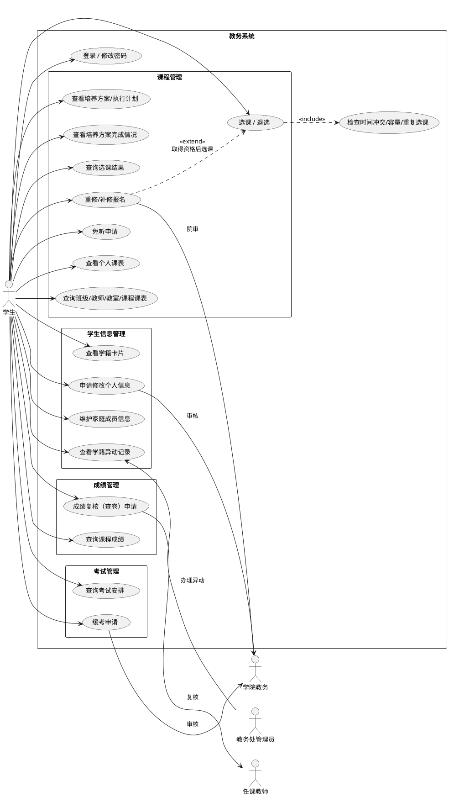

> 渲染方式：VS Code 装 PlantUML 插件，或者在 draw.io 里选“排列 → 插入 → 高级 → PlantUML”。最终文档里也可以照着重画。

### 3.2 用例清单（含输入输出）

| 编号 | 用例 | 优先级 | 输入 | 输出 |
|---|---|---|---|---|
| UC00 | 登录 / 修改密码 | 核心 | 学号、密码 | 登录态；首页显示姓名、学院、专业、班级、当前学期和周次 |
| UC01 | 查看学籍卡片 | 核心 | 无（当前登录学生） | 学籍卡片：基本信息 + 在校期间异动列表 |
| UC02 | 申请修改个人信息 | 核心 | 要改的字段、新值 | 申请记录（审核状态） |
| UC03 | 维护家庭成员信息 | 选做 | 姓名、关系、证件类型、证件号、电话、是否在职 | 家庭成员列表 |
| UC04 | 查看学籍异动记录 | 一般 | 无 | 异动类别、新旧学院 / 专业 / 班级 / 学籍状态、终审状态 |
| UC05 | 查看培养方案 / 执行计划 | 核心 | 无（按本人专业和年级） | 各学期应修课程：课程编号、名称、学分、学时、考核方式、课程性质、课程属性 |
| UC06 | 查看培养方案完成情况 | 核心 | 无 | 每门方案课程的完成情况、已修学分 / 要求学分（如 160） |
| UC07 | 选课 / 退选 | 核心 | 学年学期、选课轮次、教学班 | 选课成功或失败原因；已选列表 |
| UC08 | 查询选课结果 | 核心 | 学年学期 | 已选课程：课程编号、名称、上课老师、学分、学时、课程属性、课程性质、是否免听、修读类型 |
| UC09 | 重修 / 补修报名 | 一般 | 课程、报名类别、（替代课程） | 报名记录及其审核进度、收费 / 缴费状态 |
| UC10 | 免听申请 | 选做 | 教学班、理由 | 申请记录 |
| UC11 | 查看个人课表 | 核心 | 学年学期、周次 | 按星期 × 节次排的课表，每格包含课程、学分、属性、上课班级、校区、上课时间、地点 |
| UC12 | 查询公共课表 | 一般 | 学期、院系、班级 / 教师 / 教室 / 课程、周次、星期、节次 | 课表 |
| UC13 | 查询考试安排 | 核心 | 学年学期、学期类别（期初 / 期中 / 期末） | 课程、开课编号、课序号、授课教师、考试时间、校区、教学楼、考场、座位号、准考证号、考试方式 |
| UC14 | 缓考申请 | 一般 | 学年学期、考试（课程）、理由、证明材料 | 申请记录（待审 / 审核中 / 通过 / 不通过） |
| UC15 | 查询课程成绩 | 核心 | 开课学期、课程性质、课程名称、显示方式（最好成绩 / 全部成绩） | 成绩列表：成绩、成绩标识、学分、学时、绩点、补重学期、考核方式、课程属性、课程性质 |
| UC16 | 成绩复核申请 | 一般 | 课程、成绩项目、理由 | 申请记录：成绩项目分数、原成绩、申请时间、审核状态 |

### 3.3 核心用例详述

#### UC07 选课 / 退选

| 项目 | 内容 |
|---|---|
| 参与者 | 学生 |
| 前置条件 | 已登录；当前时间处于某个选课轮次的开放时间内；学籍状态为“在读”。 |
| 基本流 | 1. 进入选课中心，系统列出本学期开放的选课轮次（学年学期、选课名称、选课时间）【实测】。 2. 学生进入一个轮次，系统列出可选教学班（课程、学分、教师、上课时间地点、容量 / 已选）【推断】。 3. 学生选中一个教学班，系统依次校验：同一课程是否已选、与已选课程时间是否冲突、教学班是否已满、学分是否超上限【推断】。 4. 校验通过，生成选课记录，教学班已选人数 +1。 5. 学生可以在轮次开放时间内退选，已选人数 −1。 |
| 备选流 | 3a. 校验不通过，返回原因，不写库。 3b. 多个学生同时抢最后一个名额：只能成功一个（并发控制，见 §7）。 |
| 后置条件 | 选课记录生成；课表（UC11）和考试安排（UC13）都以选课记录为依据。 |
| 输入 | 学号（会话）、轮次编号、开课编号 |
| 输出 | 成功 / 失败原因；最新已选列表 |

#### UC13 查询考试安排

| 项目 | 内容 |
|---|---|
| 前置条件 | 教务已经完成排考；学生已经选了这门课。 |
| 基本流 | 学生选学年学期和学期类别（期初、期中、期末）【实测】，系统返回本人每门课的考试安排。 |
| 输出字段【实测】 | 是否缓考、课程编号、课程名称、开课编号、课序号、授课教师、考试时间、考场所在校区、考场所在教学楼、排考属性、考试地点、座位号、准考证号、成绩标识、补考负责老师（及联系方式）、考试方式、考试平台、备注 |
| 说明 | 考试安排是**以教学班为单位**的（有开课编号、课序号），座位号和准考证号是**以学生为单位**的，所以“考试”和“考生安排”要分成两个实体。“补缓考安排”和“期末安排”的表头完全相同，只是学期类别不同，说明二者是同一张表。 |

#### UC15 查询课程成绩

| 项目 | 内容 |
|---|---|
| 前置条件 | 成绩已经由教师提交、教务审核并发布（学生看不到未审核的成绩）。 |
| 查询条件【实测】 | 开课学期（含“全部学期”）、课程性质、课程名称、显示方式：**显示最好成绩 / 显示全部成绩** / 显示辅修成绩 |
| 输出字段【实测】 | 开课学期、课程编号、课程名称、分组名、成绩、成绩标识、学分、总学时、绩点、补重学期、考核方式、课程属性、课程性质、通选课类别、通选课课组 |
| 观察 | ① 成绩有**百分制**（如 89）也有**等级制**（如“优”）；② 存在“最好成绩 / 全部成绩”两种视图，说明**同一学生、同一门课可以有多条成绩**（首修、补考、重修）；③ 绩点和成绩一起显示，是换算出来的；④ 有“补重学期”字段，用来记录补考或重修发生在哪个学期。 |

#### UC02 申请修改个人信息

| 项目 | 内容 |
|---|---|
| 基本流 | 学生点“增加”，打开学生信息表单，修改字段后提交；生成一条申请，等院系审核。 |
| 表单字段【实测】 | 姓名、性别、出生日期、证件号、民族、籍贯、政治面貌、通讯地址、电话、姓名拼音、电子信箱、考生号、英文拼音、学院、生源地、专业、班级、学号 |
| 申请列表字段【实测】 | 学号、姓名、**修改字段、修改信息**、审核状态、修改时间 |
| 观察 | 申请记录不是整张学生表的拷贝，而是“改了哪个字段 → 改成什么”的**键值对**形式，一条申请可能对应多个字段。哪些字段允许学生改（推测是籍贯、政治面貌、通讯地址、电话、邮箱、拼音），本次没有提交，需要再确认。 |

### 3.4 操作清单：用例 × 数据（CRUD 矩阵）

思维导图指出：**功能需求的清单，就是数据库逻辑设计必须满足的“操作清单”的子集**。下表列出学生的每个用例对每类数据做什么操作（C 新增、R 读、U 改、D 删）。括号表示审核通过后由审核人完成的操作，不是学生直接做的。

| 用例 | 学生 | 家庭成员 | 学籍异动 | 培养方案 / 方案课程 | 课程 | 教学班 | 排课 / 教室 | 选课轮次 | 选课记录 | 考试 / 考生安排 | 成绩 | 申请单 | 审核记录 |
|---|---|---|---|---|---|---|---|---|---|---|---|---|---|
| UC00 登录 | R | | | | | | | | | | | | |
| UC01 学籍卡片 | R | | R | | | | | | | | | | |
| UC02 修改信息 | R（U） | | | | | | | | | | | C R | （C） |
| UC03 家庭成员 | | C R U D | | | | | | | | | | | |
| UC04 异动记录 | | | R | | | | | | | | | | |
| UC05 培养方案 | R | | | R | R | | | | | | | | |
| UC06 完成情况 | R | | | R | R | | | | | | R | | |
| UC07 选课 / 退选 | R | | | R | R | R U | R | R | C R U | | | | |
| UC08 选课结果 | | | | | R | R | | | R | | | | |
| UC09 重修报名 | | | | | R | | | | （C） | | R | C R | （C） |
| UC10 免听申请 | | | | | | R | | | （U） | | | C R | （C） |
| UC11 个人课表 | | | | | R | R | R | | R | | | | |
| UC12 公共课表 | | | | | R | R | R | | | | | | |
| UC13 考试安排 | | | | | R | R | R | | | R | | | |
| UC14 缓考申请 | | | | | | | | | | R（U） | | C R | （C） |
| UC15 查询成绩 | | | | | R | R | | | R | | R | | |
| UC16 复核申请 | | | | | | | | | | | R（U） | C R | （C） |

**从矩阵读出的结论：**
- 学生对数据的**写操作只有三类**：选课记录、家庭成员、各类申请单。其他数据学生都只读，所以学生账号的写权限可以收得很窄（对应 §2.3）。
- **选课记录、教学班、成绩被读得最频繁**，是建索引和优化查询的重点（对应 §7）。
- 四类申请（UC02、UC09、UC14、UC16）的模式完全相同：学生新建 → 审核人审核 → 通过后修改业务数据。这说明可以考虑用一套“申请单 + 审核记录”结构统一处理（见 §9 第 9 条）。

### 3.5 从页面反推的实体和属性

属性都来自页面上实际出现的字段【实测】。标“+”的是为了让数据完整而补充的【推断】。

| 实体 | 主要属性 | 出现的页面 |
|---|---|---|
| **学院** | 学院代码、学院名称 | 学籍卡片、课表查询（下拉项为“[代码]名称”） |
| **专业** | 校内专业名称、部颁专业名称、部颁专业代码、学制、所属学院、+专业代码 | 学籍卡片 |
| **行政班** | 班级号（如 2024211318）、+年级、+所属专业 | 学籍卡片、课表卡片“上课班级” |
| **学生** | 学号、姓名、性别、证件号、出生日期、民族、籍贯、政治面貌、生源地、高考考生号、入学日期、预计毕业日期、入学专业、通讯地址、电话、电子信箱、姓名拼音、英文拼音、照片、+学籍状态、+在校状态 | 学籍卡片、修改信息表单、首页“我的信息” |
| **家庭成员** | 姓名、关系、身份证件类型、身份证件号、联系电话、是否在职 | 家庭成员信息 |
| **学籍异动** | 异动类别、异动日期、原院系 / 专业 / 年级 / 班级 / 学籍 / 在校状态、新学院 / 专业 / 班级 / 学籍 / 状态 / 在校状态、终审状态 | 学籍异动信息、学籍卡片 |
| **信息变更申请** | 学号、修改字段、修改信息（新值）、审核状态、修改时间、+原值 | 学籍信息管理 |
| **学年学期** | 学年学期代码（如 2026-2027-1）、+开始日期、+总周数 | 所有查询页的下拉框（历史上出现过 2018-2019-3，即**小学期**） |
| **课程** | 课程编号（10 位）、课程名称、开课单位、学分、总学时、讲课 / 实践 / 讲座 / 实验 / 课外学时、考核方式、课程性质 | 执行计划、培养方案明细、成绩 |
| **培养方案** | 年级、专业、总学分要求（软件工程 2024 级：160）、培养目标 | 培养方案明细 |
| **方案课程**（培养方案 × 课程） | 课程体系（如“专业基础”）、课程属性（必修 / 选修 / 任选）、开设学期、通选课类别、是否考试 | 执行计划、培养方案明细 |
| **教师** | 姓名、+工号、+所属学院、邮箱、手机、微信、QQ | 课表、选课结果、考试安排 |
| **教学班（开课）** | 开课编号、课序号、学年学期、课程、上课校区、+容量、+已选人数、线上教学方式、教学平台、课程群 | 课表卡片、考试安排、选课结果 |
| **排课** | 教学班、周次（如“第 3-11,13,15-18 周”）、星期、起止节次（如“1[03-04]节”）、上课地点 | 课表卡片 |
| **教室** | 教室名（如“教学实验综合楼-N207”）、教学楼、校区（校本部 / 沙河 / 海南） | 课表、考试安排 |
| **节次时间** | 节次模式（默认 / 海南校区）、节次 1–14、开始时间、结束时间 | 学期课表、课程课表查询 |
| **选课轮次** | 学年学期、选课名称、选课开始 / 结束时间 | 正常选课 |
| **选课记录** | 学号、教学班、修读类型（首修 / 重修 / 补修）、是否免听、+选课时间、+状态 | 选课结果查询 |
| **考试** | 教学班（开课编号 + 课序号）、学期类别（期初 / 期中 / 期末）、考试时间、考试方式、考试平台、排考属性、补考负责老师 | 期末 / 补缓考安排 |
| **考生安排** | 考试、学号、考场（教室）、座位号、准考证号、是否缓考 | 期末 / 补缓考安排 |
| **成绩** | 学号、课程 / 教学班、开课学期、成绩（百分制或等级）、成绩标识、绩点、补重学期、分组名、学分、总学时 | 课程成绩 |
| **成绩分项** | 成绩项目、成绩项目分数 | 成绩查卷申请 |
| **缓考申请** | 学年学期、考试活动、课程、审核状态、+理由、+证明材料 | 缓考申请 |
| **重修报名** | 学年学期、课程、学时、学分、最好成绩、替代课程（编号、名称、学时、学分）、重修报名类别、上课院审、开课院审、取得资格、是否选课、是否收费、是否缴费、是否免听 | 重修 / 补修选课 |
| **复核申请** | 学年学期、课程、成绩项目、成绩项目分数、原成绩、申请时间、审核状态 | 成绩查卷申请 |

### 3.6 概念结构（学生视角 E-R 图）

为了在各种 Markdown 工具里都能渲染，实体名用英文，中文写在注释里。最终文档建议再用 Chen 式（矩形 / 菱形 / 椭圆）画一版。权限和历史相关的支撑表单独画在 §4.6。

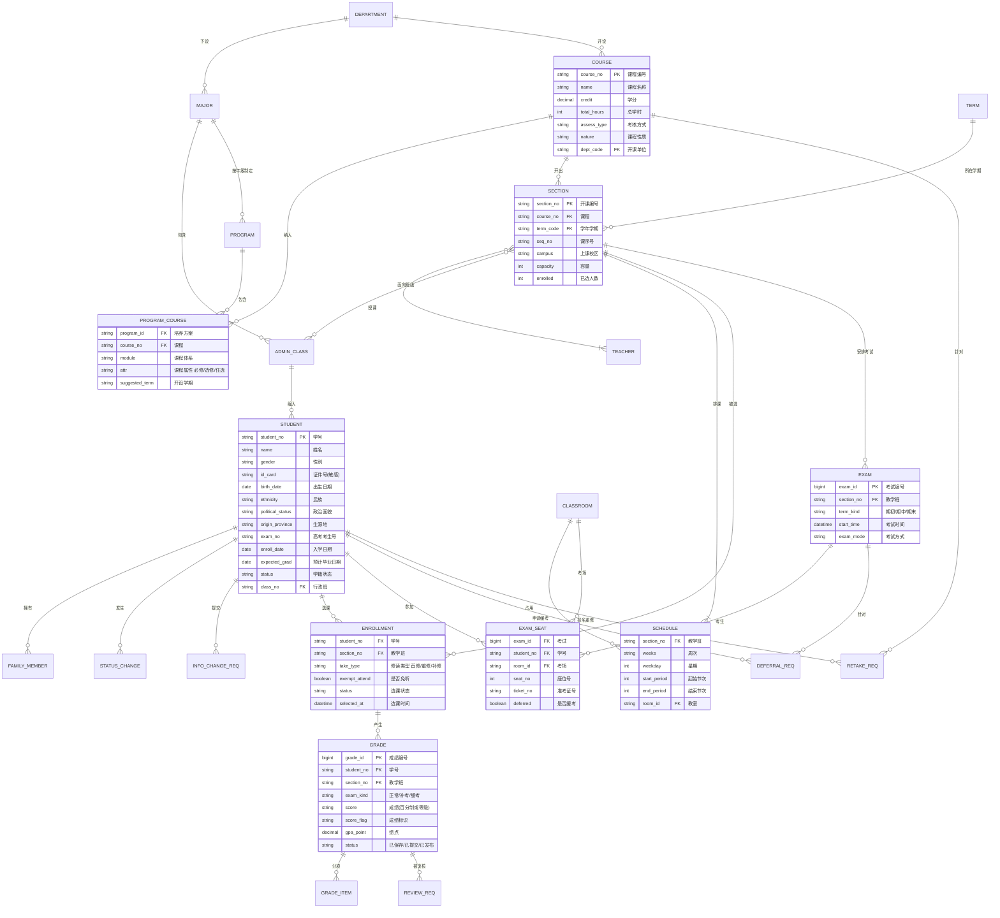

### 3.7 联系说明

| 实体 A | 实体 B | 联系 | 基数 | 联系上的属性 / 说明 |
|---|---|---|---|---|
| 学院 | 专业 | 下设 | 1 : N | |
| 专业 | 行政班 | 包含 | 1 : N | |
| 行政班 | 学生 | 编入 | 1 : N | 学籍异动时会换班，历史记录在“学籍异动”里 |
| 专业 | 培养方案 | 制定 | 1 : N | 一个专业每个年级一套方案 |
| 培养方案 | 课程 | 包含 | M : N | **课程体系、课程属性、开设学期**在联系上（同一门课对不同专业的必修 / 选修属性可能不同） |
| 课程 | 教学班 | 开出 | 1 : N | 同一门课同一学期可开多个班（课序号不同） |
| 教学班 | 教师 | 授课 | M : N | 一个班可以有多位老师，联系上可放“主讲 / 助教” |
| 教学班 | 行政班 | 面向 | M : N | 实测课表卡片的“上课班级：[2024211315-2024211319]班” |
| 教学班 | 排课 | 安排 | 1 : N | 一个班每周可上多次课 |
| 学生 | 教学班 | 选课 | M : N | **修读类型、是否免听、选课状态、选课时间**（转成“选课记录”实体） |
| 选课记录 | 成绩 | 产生 | 1 : N | 正常考试一条，补考 / 缓考再各一条 |
| 成绩 | 成绩分项 | 构成 | 1 : N | 平时、期中、期末等 |
| 教学班 | 考试 | 安排 | 1 : N | 期末一次，补缓考一次 |
| 考试 | 学生 | 参加 | M : N | **考场、座位号、准考证号、是否缓考**（转成“考生安排”实体） |

---

## 4. 问题 3：这些业务有怎样的操作流程？——数据如何被创建、修改、流转、保存

### 4.1 学生一学期的业务主线

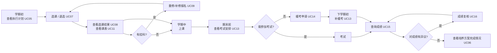

### 4.2 选课流程（含数据校验）

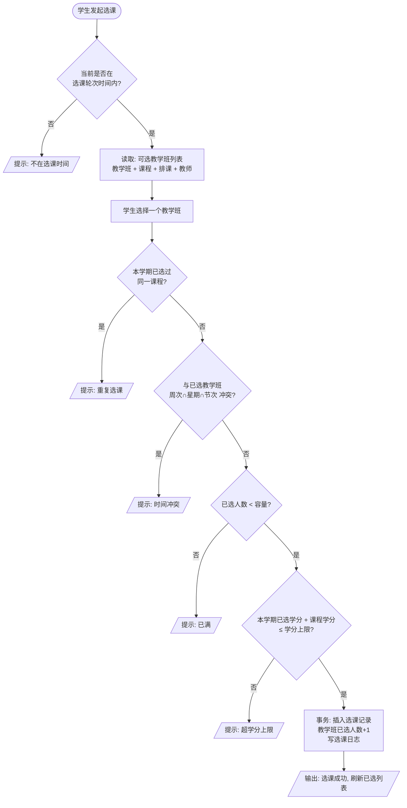

| 步骤 | 输入数据 | 输出 / 写入数据 |
|---|---|---|
| 判断轮次 | 选课轮次（开始时间、结束时间、适用年级 / 专业） | — |
| 列出教学班 | 教学班、课程、排课、教师、教室 | 可选列表 |
| 冲突校验 | 学生本学期已选的教学班的排课（周次、星期、节次） | — |
| 容量校验 | 教学班.容量、教学班.已选人数 | — |
| 落库 | 学号、开课编号、轮次、修读类型 | 新增**选课记录**一行；**教学班**.已选人数 +1；新增**选课日志**一行 |

### 4.3 成绩从产生到学生可见

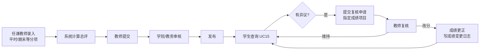

- **输入：** 选课名单（谁要有成绩）、成绩分项及其占比、记分制（百分制或等级制）。
- **输出：** 每名学生每门课的总评、成绩标识（如缺考、缓考）、绩点；学生端的最好成绩视图和全部成绩视图。
- 复核申请页【实测】的字段里有“成绩项目、成绩项目分数、原成绩”，说明后台确实存了**分项成绩**，而且更正后还要保留**原成绩**。

### 4.4 学籍信息修改申请

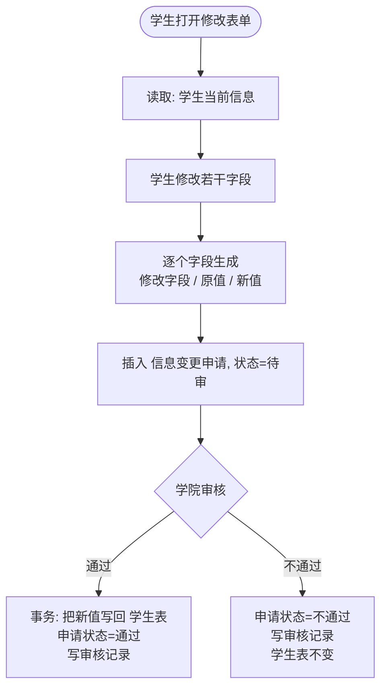

### 4.5 状态图

#### 各类申请单（信息修改 / 缓考 / 复核 / 免听）

缓考申请的筛选条件【实测】：待审、审核中、通过、不通过（页面内部编码依次为 3、2、1、0）。

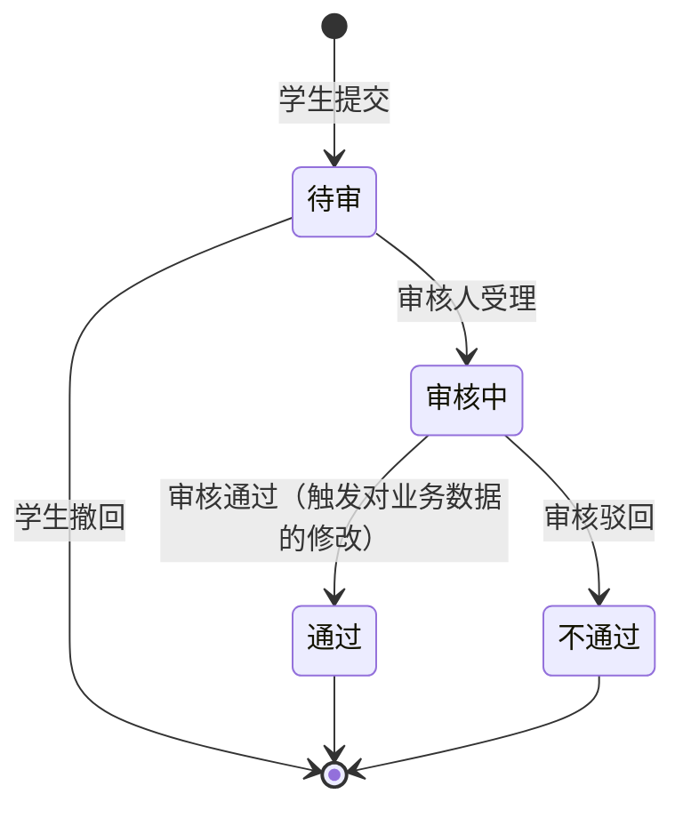

#### 重修报名

重修报名列表的列【实测】：是否报名 → 上课院审 → 开课院审 → 取得资格 → 是否选课 → 是否收费 → 是否缴费。

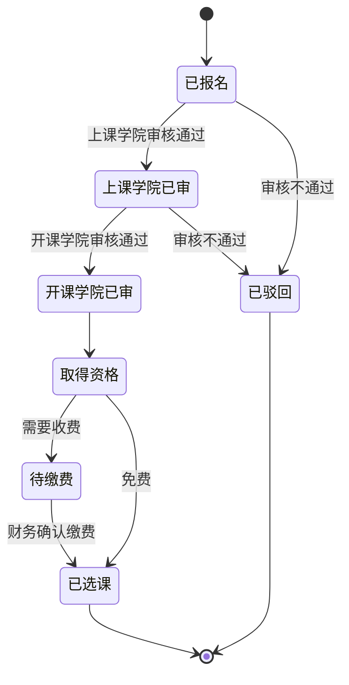

#### 选课记录【推断，下次选课开放时核实】

“选课结果查询”页的标题是“学生预选查询”，说明存在**预选（志愿）→ 筛选**的阶段。

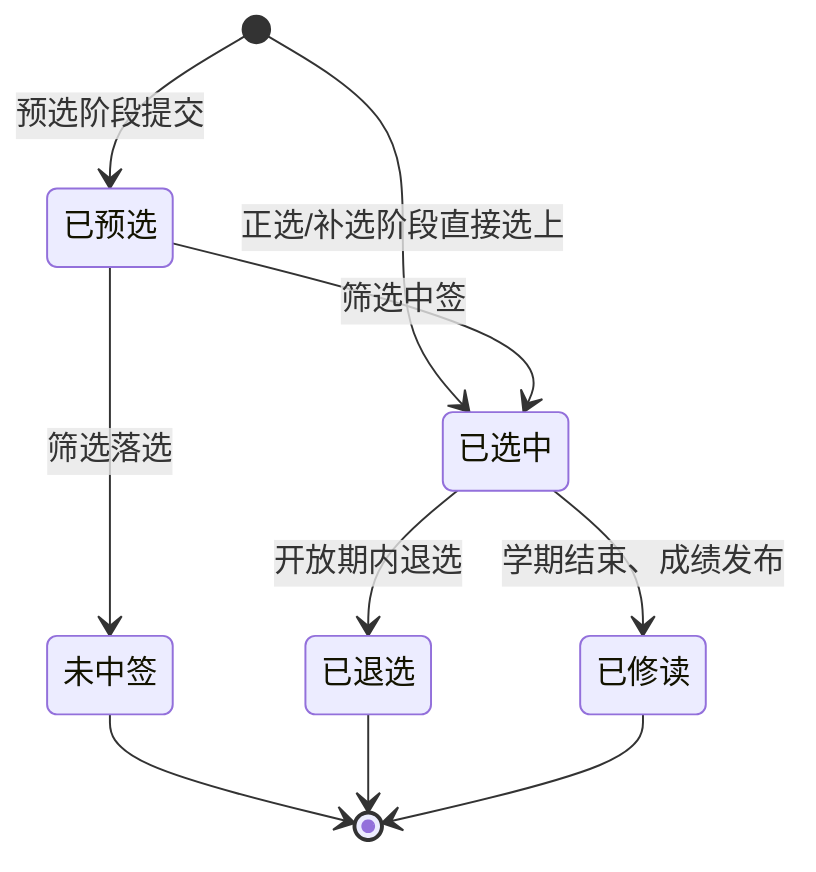

#### 成绩

思维导图中的例子：成绩在提交过程中会经过“已保存”“已提交”“已审核”等状态。学生只能看到已审核（发布）的成绩。

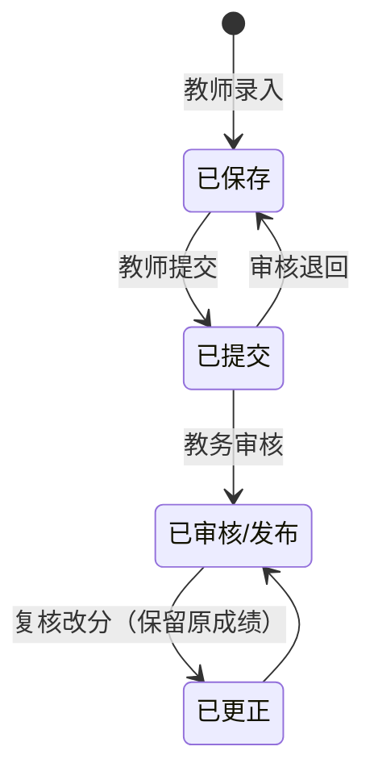

### 4.6 数据的动态变化对数据库设计的影响

思维导图给出两条：**需要为状态变化设计字段支撑；需要为状态变化设计额外的数据库表记录其历史变化轨迹。** 落到学生端涉及的数据：

| 有状态的数据 | 状态字段 | 为什么要留历史 | 历史表 |
|---|---|---|---|
| 学生 | 学籍状态、在校状态、学院 / 专业 / 班级 | 转专业、休学、复学后要能查出原来是什么 | **学籍异动**（现有系统已有，就是学生的历史表） |
| 各类申请单 | 审核状态 | 重修要经过两级院审，需要知道每一级谁、何时、什么意见 | **审核记录**（一次审核一行） |
| 选课记录 | 选课状态 | 学生说“我明明选上了”时要能查证；退选后的记录不能直接删 | **选课日志**（每次选、退一行） |
| 成绩 | 成绩状态、成绩值 | 成绩修改必须可追溯，复核页面本身就要显示“原成绩” | **成绩变更日志**（原值、新值、操作人、原因） |

权限（§2.3）和历史相关的支撑表：

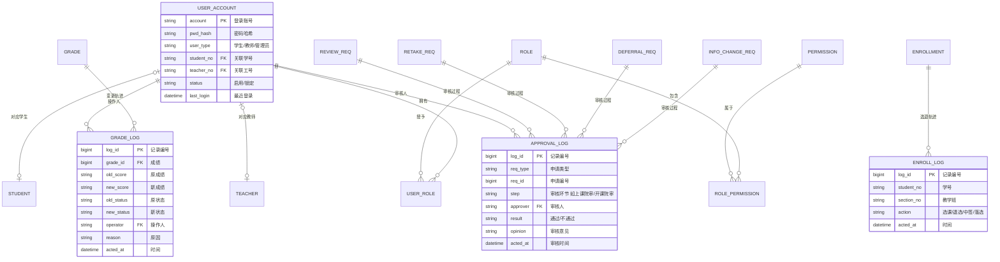

---

## 5. 问题 4：哪些业务需要别的部门支持？——系统边界

主要目标：划定职责范围，界定系统边界。

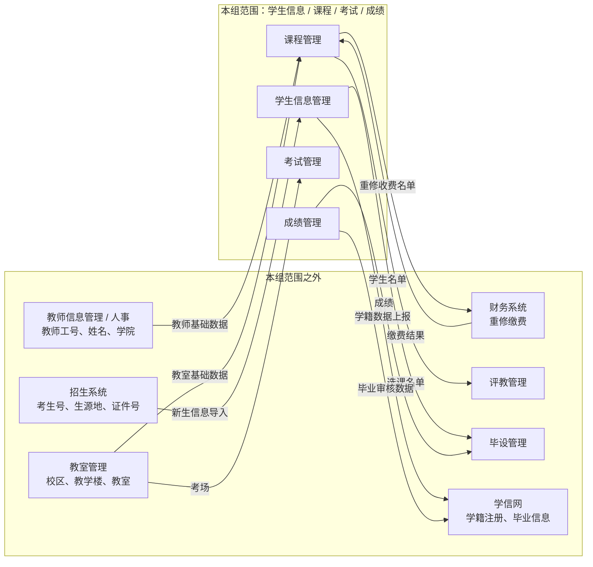

| 业务 | 需要的数据来自哪里 | 产出的数据给谁用 | 对数据库设计的影响 |
|---|---|---|---|
| 查看学籍、申请修改 | 新生入学时来自**招生系统**，之后由本系统维护 | 毕设、学信网 | 边界内数据：设计完整、规范的学生表；另设**导入批次**记录导入来源 |
| 培养方案、选课、课表 | 全部来自内部；但教师来自**人事**，教室来自**教室管理** | 评教（选课名单） | 教师、教室在本系统只做**镜像表**，只保留本系统需要的字段（工号、姓名、学院；教室号、楼、校区、座位数），定期同步、只读 |
| 重修报名 | 内部；缴费状态来自**财务** | 财务（收费名单） | 需要**数据传输接口**：向财务推送应收名单，接收缴费结果回写“是否缴费” |
| 考试安排 | 内部；考场来自教室管理 | — | 考场容量取自教室镜像表 |
| 成绩 | 完全来自内部 | 毕设、学信网、可信证明 | 边界内核心数据，表结构必须完整、规范，并保留历史 |

> 说明：课程资料的结构图里，毕设管理、教室管理、评教管理、教师信息管理也挂在“教务系统”下面。本文把它们当作**本组范围之外**的子系统，这是我们的理解，需要和老师确认（见 §10）。

---

## 6. 问题 5：哪些是核心业务，哪些是非核心业务？

对数据库设计的影响：重要的核心业务要不惜成本保证绝对可靠；次要的业务可以灵活权衡。这条结论会指导物理设计和性能调优。

| 业务 | 核心？ | 理由 | 数据库层面的要求 |
|---|---|---|---|
| 成绩查询与复核 | **核心** | 影响毕业、保研、奖学金，错一分都会出事 | 事务 + 外键约束；成绩变更日志；主从复制 + 定期全量备份 + binlog，保证可恢复到任意时间点 |
| 选课 / 退选 | **核心** | 开放瞬间高并发，超选或丢记录会引发大规模投诉 | 容量检查和计数必须在同一事务；选课日志；高峰期性能（见 §7） |
| 学籍基本信息 | **核心** | 所有业务的主数据；含敏感信息 | 主键、唯一约束；敏感字段加密；修改必须走申请 + 审核 |
| 考试安排查询 | **核心** | 时间、地点、座位错了学生会缺考 | 由排考结果生成后只读；发布前校验冲突 |
| 培养方案完成情况 | 一般 | 由成绩和培养方案计算得出，可以重算 | 可以用视图或定时计算的汇总表，允许短时间不一致 |
| 个人课表、公共课表 | 一般 | 由选课和排课派生 | 可以缓存；学期内基本不变 |
| 家庭成员、免听、专业分流 | 非核心 | 低频、影响面小 | 普通表即可，不必为它们做特殊优化 |

---

## 7. 问题 6：学生最不希望系统出什么问题？——非功能需求

| 学生最不希望遇到的情况 | 需求类别 | 对数据库设计的影响 |
|---|---|---|
| 选课开放时页面卡死，或显示选上了结果被挤掉 | 性能 + 一致性 | 选课记录（学号、学期）、教学班（课程、学期）上建索引；用 `UPDATE … SET enrolled = enrolled + 1 WHERE section_no = ? AND enrolled < capacity` 这类带条件的更新或行锁防止超选；教学班上冗余“已选人数”计数，避免每次 `COUNT(*)` |
| 自己的成绩、证件号被别人看到 | 安全 | 证件号、电话等字段**加密存储**（如 AES），查询时脱敏；按角色授予视图权限（§2.3） |
| 成绩被人悄悄改了 | 安全 + 可靠 | 成绩变更日志；成绩表只有审核流程能改 |
| 服务器坏了，历史成绩没了 | 可用性与可靠性 | 主从复制、备份策略；核心表用支持事务的 InnoDB |
| 查四年的成绩要等很久 | 性能 | 成绩表按学号建索引；查询“最好成绩”时考虑视图或冗余标志（§9 第 5 条） |
| 新校区、小学期、辅修出现后系统出错 | 可扩展性 | 学期、校区、节次模式都做成数据而不是写死；为字段预留容量（例如学分用 `DECIMAL(4,2)`，周次位串留到 20 周）；历史学期的数据量大了以后可以考虑**库表分离**，把已毕业学生的数据归档 |

---

## 8. 数据字典（学生相关数据项）

数据类型按 MySQL 写。“取值 / 格式”一列中标【实测】的来自现有系统的页面或下拉框。示例值都是虚构的。

| 数据项 | 含义 | 类型 | 取值 / 格式 | 所属实体 |
|---|---|---|---|---|
| 学号 | 学生唯一标识 | `CHAR(10)` | 10 位数字，前 4 位为入学年份【实测】，例 `2024211001` | 学生、选课记录、成绩、考生安排 |
| 姓名 | 学生姓名 | `VARCHAR(50)` | 需支持少数民族长姓名 | 学生 |
| 性别 | | `CHAR(1)` 或 `ENUM` | 男 / 女 / 未说明的性别【实测】 | 学生 |
| 证件号 | 身份证或其他证件号 | `VARBINARY(64)` | 加密后存储；明文 18 位 | 学生、家庭成员 |
| 民族 | | `CHAR(2)` | 国家标准民族代码，显示时转名称【实测：56 个民族下拉】 | 学生 |
| 政治面貌 | | `CHAR(2)` | 中共党员、中共预备党员、共青团员、各民主党派、无党派民主人士、群众【实测】 | 学生 |
| 学籍状态 | | `VARCHAR(10)` | 在读 / 休学 / 退学 / 毕业 / 结业【推断】 | 学生 |
| 班级号 | 行政班标识 | `CHAR(10)` | 10 位数字【实测】，例 `2024211301` | 行政班、学生 |
| 学院代码 | | `VARCHAR(10)` | 下拉框格式“[代码]名称”，例 `[202000]教务处`【实测】 | 学院 |
| 学年学期 | 学期标识 | `CHAR(11)` | `YYYY-YYYY-N`，N ∈ {1, 2, 3}，3 为小学期【实测】，例 `2026-2027-1` | 学年学期、教学班、成绩 |
| 课程编号 | 课程唯一标识 | `CHAR(10)` | 10 位数字【实测】，例 `3132111390` | 课程 |
| 学分 | | `DECIMAL(4,2)` | 实测有 0.4、0.5、1、2、3 等 | 课程、成绩 |
| 总学时 | | `SMALLINT` | = 讲课 + 实践 + 讲座 + 实验 + 课外学时【实测】 | 课程 |
| 考核方式 | | `ENUM` | 考试 / 考查【实测】 | 课程 |
| 课程性质 | | `VARCHAR(20)` | 思想政治理论课、公共课、专业课、实践教学课、校级双创课、院级双创课、其他【实测】 | 课程 |
| 课程属性 | 对某专业而言的修读要求 | `VARCHAR(10)` | 必修 / 选修 / 任选【实测】 | 方案课程 |
| 开课编号 | 教学班唯一标识 | `VARCHAR(32)` | 具体格式未见，待确认 | 教学班 |
| 课序号 | 同课程同学期的班号 | `VARCHAR(10)` | | 教学班 |
| 周次 | 上课周 | `CHAR(20)` | 位串，第 i 位为 1 表示第 i 周上课；页面显示为“第 3-11,13,15-18 周”【实测】 | 排课 |
| 星期 | | `TINYINT` | 1–7 | 排课 |
| 节次 | | `TINYINT` | 1–14【实测】；第 1 节 08:00–08:45 ……第 14 节 20:10–20:55 | 排课、节次时间 |
| 校区 | | `VARCHAR(10)` | 校本部 / 沙河校区 / 海南校区【实测】 | 教室、教学班 |
| 修读类型 | | `VARCHAR(10)` | 首修 / 重修 / 补修【实测：首修】 | 选课记录 |
| 是否免听 | | `TINYINT(1)` | 0 / 1【实测】 | 选课记录 |
| 学期类别 | 考试批次 | `TINYINT` | 1 期初、2 期中、3 期末【实测编码】 | 考试 |
| 座位号 | | `SMALLINT` | | 考生安排 |
| 准考证号 | | `VARCHAR(20)` | | 考生安排 |
| 成绩 | 总评 | `VARCHAR(10)` | 百分制数字或等级（如“优”）【实测】 | 成绩 |
| 记分制 | | `VARCHAR(10)` | 百分制 / 五级制 / 二级制【推断】 | 成绩 |
| 成绩标识 | 特殊情况 | `VARCHAR(10)` | 缺考 / 缓考 / 违纪等【推断】，正常时为空 | 成绩 |
| 绩点 | | `DECIMAL(3,2)` | 由成绩按规则换算，例 3.77【实测】 | 成绩 |
| 审核状态 | 申请单状态 | `TINYINT` | 3 待审、2 审核中、1 通过、0 不通过【实测编码】 | 各类申请单 |

---

## 9. 对后续数据库设计的启示

这些点在设计阶段要有意识地处理，答辩时也可以作为亮点。评分标准要求“有限的反范式操作应该是权衡后的有意识行为”，下面标 ⚖ 的就是需要写清楚权衡的地方。

1. **“上课时间”不满足 1NF。** 现有系统把时间存成“第 3-11,13,15-18 周 1[03-04]节”这样的字符串，要拆成排课表（星期、起止节次、周次）。⚖ 周次可以每周一行（规范，但冲突检测要大量连接），也可以存成 20 位位串（冲突检测只需按位与）。
2. **学期不能假设一年只有两个。** 历史数据里有“-3”小学期，所以学年学期要做成独立的表。
3. **课程和教学班要分开。** 课程编号是目录层面的，开课编号 + 课序号才是某学期具体的班。课表、选课、考试、成绩都挂在教学班上。
4. **课程属性属于“培养方案 × 课程”这个联系，而不是课程本身。** 否则同一门课对不同专业的必修 / 选修区别就存不下。
5. ⚖ **同一门课可以有多条成绩。** “最好成绩”视图由查询算出，还是在成绩表上加一个“是否最好成绩”标志，要权衡。
6. ⚖ **成绩值有两种记分制。** 需要“记分制”字段，或者同时存“等级”和“折算分”；**绩点**由换算规则得到，查询很频繁而规则很少变，可以考虑冗余存储。
7. ⚖ **成绩表上冗余存了学分、学时、课程性质。** 这是快照：培养方案修订后课程学分可能变，但历史成绩要按当时的学分算。
8. ⚖ **教学班上的“已选人数”是冗余计数。** 可以由选课记录 `COUNT` 得到，但选课高峰期每次都数代价太大，而且容量检查需要它。
9. **申请单的统一。** 四类申请状态机相同（§4.5），可以抽象出“申请单”父表（申请类型、学号、状态、提交时间）+ 各类型明细子表 + 统一的审核记录表；也可以各建各的表。前者便于统一审核和统计，后者结构简单。
10. ⚖ **信息变更申请采用键值对形式**（修改字段、修改信息）。好处是一张表覆盖所有字段；代价是没法用外键或类型约束检查新值。
11. **多校区节次时间不同。** 有“默认节次模式”和“海南校区课表时间”，所以节次时间表要按校区（或节次模式）区分。

---

## 10. 待组内确认的问题

1. **模块范围：** 课程资料的结构图里，毕设、教室、评教、教师信息四个模块也挂在教务系统下面。本文把它们当成本组范围之外（教师、教室只做镜像表），是否需要和老师确认？
2. **核心与选做：** 建议选课 + 重修放进课程管理核心，缓考放进考试管理，免听、免修、专业分流作为选做。
3. **成绩分项要不要建模？** 学生端只看到总评，但复核页面出现了“成绩项目”。建议建模，否则教师端的“录入平时 / 期末成绩”没法设计。
4. **选课规则：** 采用“预选 + 筛选”还是“先到先得”？两者的选课记录状态不同（见 §4.5）。
5. **学分上限、先修课程：** 现有系统学生端看不到，是否纳入选课校验？

---

## 11. 下一步

| 时间 | 任务 |
|---|---|
| 本周（11-03 至 11-09） | 分组；准备 MySQL 环境；组内确认第 10 节的问题；按同样方法整理**教师端**（成绩录入、课表、考试监考）和**教务管理员端**（培养方案、开课排课、选课轮次、排考、成绩审核） |
| 11-10 | 合并三个角色，形成完整的用例图、操作清单、概念结构和数据字典；写需求分析文档 |
| 11-17 | **需求检查点**（检查需求分析，随后改进） |
| 11-24 | 数据库设计（逻辑结构、物理结构），写设计文档 |
