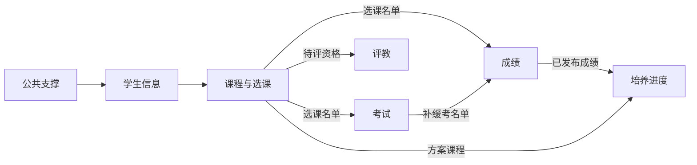
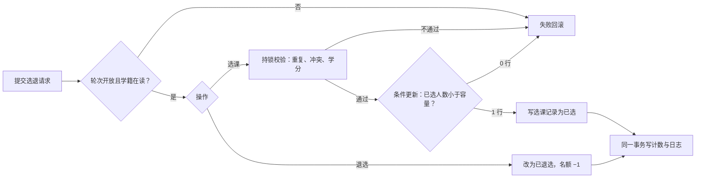
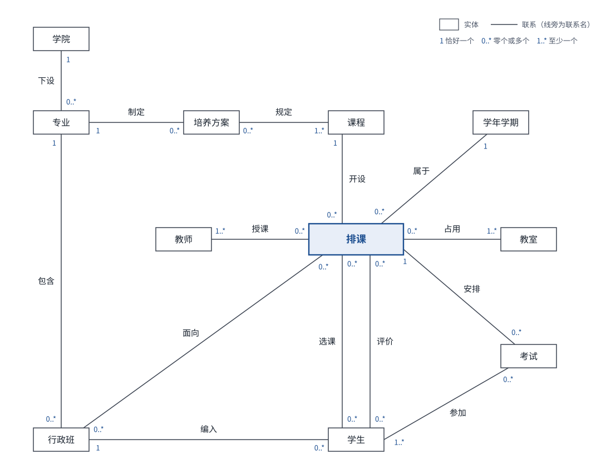

# 教务系统设计说明书

数据库系统原理课程设计 · 第二阶段（设计） · 依据需求分析文档 v0.2 · 2026 年 11 月 24 日修订

## 1. 设计依据与范围

以 [《教务系统需求分析文档》](需求分析文档.md) v0.2 为基线，沿用学生、任课教师、管理员三类业务角色，以及学生信息、课程与选课、考试、成绩、评教五个业务模块。账户、权限、审核与日志为公共模块。教师和教室由外部子系统同步，毕设与学信网上报使用授权导出。设计交付包括模块与核心流程、关系模式与规范化分析、MySQL 物理结构和建表脚本。

### 1.1 设计阶段目标

下表按课程要求的设计阶段必做、选做内容和评分标准，列出本阶段要达成的目标及其所在章节。

| 设计阶段目标 | 来源 | 本文位置 |
|---|---|---|
| 功能模块划分合理，能与需求对齐 | 必做“功能模块设计”；评分标准 | 第 2 节，用例编号沿用需求文档，给出模块输入、输出与数据归属 |
| 流程设计精确反映业务需求 | 必做“核心模块流程设计”；评分标准 | 第 3 节，明确状态、准入校验、事务写入点和失败出口 |
| 逻辑结构符合数据库设计规范，有限的反范式是权衡后的有意识行为 | 必做“逻辑结构设计”；评分标准 | 第 4 节，E-R 到关系模式的映射、主外键、规范化分析与有意保留的冗余 |
| 物理结构设计有设计依据，并能实际建库 | 必做“物理结构设计”；评分标准 | 第 5 节，按实际查询路径解释键、索引、约束与存储选型；第 6 节为 [MySQL 建表脚本](../sql/02-schema.sql)的实测记录 |
| 系统安全性、访问权限模型 | 选做 | §5.4 角色权限、视图与外部接口；§5.1 敏感字段加密 |
| 系统并发性能 | 选做 | §5.3 锁顺序与失败处理；§6.2 抢最后一个名额的实测 |
| 索引、物理存储架构 | 选做 | §5.2 索引与访问路径；§5.1 存储与容量假设 |
| 需求检查点结论在设计中全部落实 | 需求分析文档 §10 | §1.2 |

术语沿用课程要求，教学班的业务属性并入排课（`section`）。一次排课可以有多条上课安排（`schedule`）。

### 1.2 需求检查点结论的落实

| 结论（需求分析文档 §10） | 设计中的落实 |
|---|---|
| 选课不抽签，指定时间统一开放、先到先得，正选后约一周有退补选 | 轮次只有正选（`MAIN`）、退补选（`ADD_DROP`）两类，都按提交先后占名额；选课记录只有已选、已退选、已修读三种状态（§3.3） |
| 先评教才能看成绩 | 课程所在学期已开放的评教批次中，学生还有未提交的待评任务时，查不到该学期成绩（§3.5、视图 `v_student_grade`） |
| 学籍异动由管理员直接办理 | 管理员以一笔事务写入学籍新状态和新旧班级历史，不经申请（§3.1） |
| 管理员合并，多级审核简化为一次 | 七类申请共用一套状态机，只审批一次（§3.6） |
| 一个排课可以有多位任课教师（检查点后补充） | 授课分主讲、合讲，每个排课恰好一位主讲，负责录入、提交成绩和发起更正，合讲教师只读；合讲的课学生对每位教师分别评教（§3.2、§3.5、§3.6） |
| 只有公共选修课会因人数不足停开（检查点后补充） | 排课记开课类别和最低开课人数，正选后只对公共选修课执行停开（§3.3） |

教师和教室只同步必要字段与来源。调课、重修与补修、缓考、成绩更正等一般用例纳入设计，家庭成员、免听和评教进度按选做保留数据结构。

## 2. 系统功能模块设计

图 1 展示各模块主要数据依赖。选课名单供课表、排考、成绩和评教复用，各模块维护自己的业务状态，跨模块审批只经规定的写入入口。



*图 1　教务系统模块及主要数据依赖*

| 模块 | 用例 | 输入与职责 | 持久化输出和共享边界 |
|---|---|---|---|
| 学生信息 | S01–S08 | 从招生系统导入已报到新生，按专业和年级分班。学生查询本人学籍，提交字段变更，管理员审批或办理学籍异动 | 导入批次、学生、行政班、异动历史、申请与审核记录。教师名单仅共享学号、姓名和行政班 |
| 课程与选课 | K01–K20（含 K08a、K10a） | 维护基础数据、课程和培养方案。生成排课、安排主讲与合讲教师及教室、开放正选与退补选、停开人数不足的公共选修课、处理调停课，并派生课表、课程名单和培养完成情况 | 培养方案、排课、上课安排、选课记录与日志。输出考试、成绩、评教所需名单 |
| 考试 | E01–E06 | 从常规考试、补考或缓考来源名单排考，分配考场、座位和监考，办理缓考 | 考试、考场容量快照、考生座位、准考证与监考记录。向成绩登记提供考试轮次与适用名单 |
| 成绩 | G01–G12 | 开放成绩录入，教师按班设置构成、录入和提交，管理员审核发布，学生查询，按申请处理复核与更正 | 成绩登记单、分项、已发布成绩、登记单操作历史及更正日志。仅向培养进度交付已发布成绩 |
| 评教 | P01–P06 | 维护版本化指标与批次，生成待评名单，收集量化得分和意见并按授课汇总 | 对象、待评资格、原始评价和批次汇总。教师仅可按本人授课查询批次汇总 |
| 账户与公共支撑 | C01、A01–A04 | 登录、改密、角色和权限点、外部镜像同步、操作追溯 | 账户、角色授权、教师与教室镜像、审核与操作日志 |

## 3. 核心业务与事务设计

所有写入入口先校验会话身份、权限点和数据范围，再按下述约定校验状态。业务更新与对应成功日志同事务提交，校验失败则回滚。开放窗口按 `开始时间 ≤ 当前时间 < 结束时间` 判定。本文的事务步骤是实现约定，附件 SQL 提供表、键、单行检查约束和查询视图。

### 3.1 新生导入与学籍维护（S01、S02、S05、S06）

1. 管理员输入招生批次标识、新生名单和分班方案。导入前校验文件摘要、学号重复、专业年级与班级匹配。以来源系统和来源批次号去重。相同摘要的成功批次可直接返回结果，同编号异摘要或已存在学号进入人工核对。
2. 写入时锁定批次，在一笔事务内创建或匹配行政班、插入学生、置批次为已导入并记录操作者。失败回滚学生和班级写入，批次错误由独立事务记录后可复查。
3. 学生在学籍卡片查看本人信息和历史；修改电话、邮箱、地址或姓名拼音时，生成申请单及加密的前后值。管理员锁定申请与学生，校验状态、白名单和原值。通过后写回字段并记录审批，原值已过期则返回冲突。管理员直接办理学籍异动时，以同一事务写入学籍新状态和新旧班级历史。

### 3.2 开课、排课与调停课（K01–K08a、K19–K20）

1. 按学期、培养方案建议开课学期和行政班生成计划内排课；公共选修课由管理员单独新建，记最低开课人数，不面向行政班。填写课程在本次开课采用的学分、学时、性质与考核方式。安排任课教师，每个排课恰好一位主讲，其余为合讲；维护面向行政班。相同学期、课程和课序号重复时返回已有排课或提示冲突。
2. 管理员输入排课、上课周集合、星期、节次范围和教室。展开周次并以上课教室所在校区的节次表换算实际时间。检查同一日期且实际时间重叠时的教室、有效授课教师、面向行政班以及已选学生。教室座位数须覆盖排课容量，节次必须存在于校区节次表。发布后由选课关系生成个人课表，按授课关系生成教师课表与名单。
3. 调停课用申请记录保留原上课安排与拟变更内容。批准时锁定学期与原上课安排，核对原版本并复算冲突；部分调课或停课只替换受影响的周。变更教师时更新有效周次对应的任课关系，有新老师时先登记其排课授课关系。整笔批准事务内同步审批与上课安排，学生课表随后按有效记录读取。

### 3.3 选课、退选与停开（K09–K12、K16、K18）



*图 2　正选、退补选中选课与退选的写入时点*

- 一学期有正选（`MAIN`）和退补选（`ADD_DROP`）两类轮次，都是先到先得，不抽签。正选在管理员设定的时间统一开放；退补选在正选之后约一周开放，可以退掉已选的课，也可以补选还有余量的课。轮次包含类型、时限、可选排课、适用行政班和学分上限。适用行政班为空时表示该轮次对符合其它条件的学生开放。必须核对排课与轮次同学期。开放期内不允许变更影响已选名单的基础规则，确需调整时暂停轮次并重新校验。
- 选课在持锁后校验在读、排课状态、本人在本学期是否已选同一课程、课表冲突及学分上限。按排课行做条件更新，只有 `enrolled_count < capacity` 时增加 1，更新到 0 行即已满。选课记录、计数和日志同一事务提交。重复请求读取已有结果，已选记录再次选入不会再加人数。正选开放的那一刻全校学生同时提交，是全系统并发最高的时刻，名额只能靠这条带条件的更新分配，不能先查余量再更新。
- 退选只对本人且处在开放轮次内生效，从 `ENROLLED` 改为 `DROPPED` 并释放名额。退补选中重新选回同一排课时复用原选课记录，改回 `ENROLLED`。管理员手工加选、退选沿用同一计数与冲突规则，写明事由。已结束的 `COMPLETED` 占用历史人数并保留记录。重修、补修须有已通过且无需缴费或已缴费的资格；免听批准在原选课记录上设置标记。
- 正选结束后，管理员对开课类别为公共选修课（`PUBLIC_ELECTIVE`）且已选人数低于最低开课人数的排课执行停开（K11）：锁定排课，状态改为 `CANCELLED`，其有效选课逐条改为 `DROPPED` 并写 `ADJUST` 日志，计数随之归零。计划内课程（必修、专业选修）不停开。被停开的学生在退补选中改选。

### 3.4 排考、发布与缓考（E01、E03、E05–E06）

1. 管理员输入目标排考学期、考试类别、考试性质及计划。正考名单取采用考试考核方式的排课有效选课记录。补考名单取已发布成绩中符合规则的学生，缓考名单取已批准的正考考生。原开课学期从排课取得，次学期期初补缓考单独记录实际考试学期。
2. 生成考试、多个考场及各考场的学生座位。检查选课记录归属本排课、考场启用、占用时间、座位及考场人数上限、学生与监考教师时间冲突。时间统一按半开区间判断重叠。保留每个考场排考时的考试容量，防止镜像更新改变历史座位依据。
3. 草稿发布时在同一写入事务中复算冲突、补缓考名单和容量，生成发布状态。学生按本人选课记录查询已发布的考试，教师按本人监考关系查询。缓考通过后锁定对应座位记录，标记缓考并写入审批日志，后续排考据此派生缓考资格。正考成绩可用 `DEFERRED` 标识保留。

### 3.5 成绩录入、审核、发布与更正（G01–G10）


*图 3　提交与审核按登记单进行，发布后的更正按单个学生成绩进行*

1. 管理员按统计学期和考试性质设置录入时间窗，生成排课登记单。只有该排课的主讲教师（`section_teacher.duty = 'LEAD'`）能编辑、提交未提交的登记单，通常须在录入期内操作；合讲教师只读。百分制构成比例和必须为 100%，同一分项按 0–100 录入，总评按加权后四舍五入到两位小数。等级制录入明确的等级代码并匹配版本化规则。缺考、违纪、缓考等使用标识记录。
2. 导入或保存先校验学生名单及成绩分项归属，在一个登记单事务中写分项与总评。构成有成绩后锁定，需调整时由教师确认重新录入并留下操作记录。考查课提交时以当时有效的选课名单为准，名单录齐后，在同一事务内清理退选学生的草稿成绩及分项。考试课使用考试名单。提交后冻结录入权限，管理员审核通过即发布，也可退回并注明意见。退回记录允许任课教师在截止后修订和重提这份登记单。
3. 学生只查本人已发布、且课程所在学期已评完教的成绩：该学期已开放的评教批次中，本人的待评任务（`eval_assignment`）必须都已有评价（`evaluation`），否则该学期成绩不返回，服务层提示还没评的课程和教师。“全部”保留每次首修、重修、补考和缓考结果。“最好”按学生、课程分组，先比较是否通过，再按统一比较分、绩点、发布时刻和成绩编号稳定排序。培养方案完成情况按版本化的通过规则和学分快照累计，同一门方案课程只计一次。
4. 已发布成绩由主讲教师发起更正，申请保存旧版本和前后值。管理员只提交审核结论。批准事务锁定申请、登记单及成绩，校验预期版本；通过时按原记分规则复算成绩和绩点，更新分项、总评与版本，写审批记录和前后快照。驳回或原版本变化时，旧成绩继续可见。一次更正仅能产生一条生效日志。

### 3.6 评教批次与审核复用（P01–P06）

- 管理员选择指标版本和学期，检查指标权重合计 100%，按有效选课和授课关系生成待评任务。每个批次下以“排课、教师”确定一个评教对象，合讲的排课每位任课教师各一个对象，每个符合资格的学生对应一次提交机会。待评任务同时是“先评教才能看成绩”的判断依据（§3.5）。批次名单在开放后冻结，应评人数由该名单确定。
- 学生提交时按会话比对任务归属、批次时间与状态，验证指标集合及每项分值，写入一次总分和分项。总分按各项得分与满分比值加权得出。结束后先关批次，再计算总均分、指标均分和参评率，完成后一次性切换到 `AGGREGATED`。教师只查询本人汇总和人数，原始身份及文字意见均无教师端查询入口。小样本发布门槛在启用时由学校明确，允许服务层屏蔽样本过少的结果。
- 七类申请共用 `request` 与 `approval_log`。提交生成 `PENDING`，处理可转 `IN_REVIEW`；申请人可在受理前撤回；审批者写入通过或驳回。成绩复核由主讲教师处理，其余审批按对应管理员权限执行。通过后必须与业务生效写入同一事务。再次处理同一终态请求时返回既有结果。


## 4. 数据库逻辑结构设计

### 4.1 从概念 E-R 模型到关系模式



*图 4　需求分析文档 v0.2 的总体 E-R 图，各模块的分图见需求分析文档 §3.6*

图中每种实体先映射为主表，再按联系的多重性和业务属性落到外键、关联表或事务记录。排课（`section`）表示某门课程在某学期的一次具体开设。占用联系产生上课安排（`schedule`），由周次、星期、连续节次和教室确定何时何地上课。

| 图 4 实体 | 关系表 |
|---|---|
| 学院、专业、行政班、学生 | `department`、`major`、`admin_class`、`student` |
| 培养方案、课程、学年学期 | `program`、`course`、`term` |
| 教师、排课、教室、考试 | `teacher`、`section`、`classroom`、`exam` |
| 分模块图中的选课轮次、成绩登记单、评教批次、各类申请单等 | `selection_round`、`grade_sheet`、`eval_batch`、`request` 及各明细表 |

| 图 4 联系 | 关系表与映射方式 |
|---|---|
| 下设、包含、编入 | `major.department_code`、`admin_class.major_code`、`student.class_no` 分别引用一端 |
| 制定 | `program.major_code` 引用专业，专业和入学年级共同确定方案 |
| 规定 | `program_course` 关联方案、课程，并保存课程属性和建议修读学期 |
| 开设、属于 | `section.course_code`、`section.term_code` 分别引用课程和学期 |
| 授课 | 多对多，落为 `section_teacher`，以（排课，教师）为 PK，保存角色主讲 / 合讲；生成列加唯一键保证每个排课至多一位主讲 |
| 占用 | `schedule` 关联排课与教室并保存星期、节次。`schedule_week` 展开周次，`schedule_teacher` 记录该安排的实际任课教师 |
| 面向 | `section_class` 关联排课与行政班 |
| 选课 | `enrollment` 关联学生与排课，通过 `round_section` 关联选课轮次。`enroll_log` 记录多次选退操作 |
| 安排 | `exam.section_id` 引用原排课，实际考试学期单独引用 `term` |
| 参加 | `exam_room` 关联考试与教室。`exam_seat` 通过 `enrollment` 识别考生并记录考场、座位、准考证 |
| 评价 | 联系属性“被评教师”须是该排课的任课教师，所以 `eval_target` 以批次、排课和教师确定对象，并以（排课，教师）外键引用 `section_teacher`；`eval_assignment` 关联对象与有效选课，`evaluation` 和 `eval_answer` 保存提交与指标得分 |

概念阶段的选课联系包含成绩属性。由于一次选课可以对应正考、补考或缓考的多份成绩，逻辑层用 `grade_sheet` 表示一次登记与发布，`grade` 通过登记单和选课标识一次成绩，`grade_item` 保存分项。

需求文档把授课画成带“角色”属性的多对多联系，把被评教师记为评价联系的属性。逻辑层把授课落为 `section_teacher`，评教对象 `eval_target` 用外键引用它，保证学生只能评该排课的任课教师；教师按本人授课关系查询汇总。待排课草稿可暂缺任课人或上课安排，上线选课前再满足“恰好一位主讲”等业务条件。

### 4.2 关系模式与键

表中 PK 为主键，UQ 为候选键或业务唯一约束，→ 为外键指向。提高辨识度的主要字段在此列出，全部字段、类型、允许空值和默认值以 SQL 为准。

| 关系 | 主键、外键与主要属性 |
|---|---|
| `department`、`major`、`admin_class` | 依次以学院编码、专业编码、班号为 PK。专业→学院，行政班→专业，年级存于行政班 |
| `term`、`campus`、`period_time` | 学期以学期编码为 PK，存开学日、周数和当前学期标志。校区编码为 PK。节次 PK 为（校区，节次），存起止时刻 |
| `teacher`、`classroom` | 分别以工号、教室编码为 PK。教师→学院，教室→校区。保存有效状态、来源、同步时间和业务所需属性 |
| `import_batch`、`student` | 批次 PK 为批次 ID，UQ（来源系统，来源批次号）。学号为学生 PK，→行政班与导入批次。学籍状态与联系字段随业务更新 |
| `family_member`、`status_change` | 家庭成员 PK（学号，成员序号）。异动以异动 ID 为 PK，→学生、操作账户和新旧班级，保存新旧状态和生效日期 |
| `user_account`、`role`、`permission` | 账户、角色、权限分别用 ID、角色码、权限码作 PK。登录名、关联学号、关联工号分别唯一，一账户至多绑定一种业务身份 |
| `user_role`、`role_permission`、`operation_log` | 两张授权表用两端键作复合 PK。日志以日志 ID 为 PK，→账户，存操作类型、对象引用、结果和时间 |

| 关系 | 主键、外键与主要属性 |
|---|---|
| `course`、`program`、`program_course` | 课程编码为课程 PK，→开课学院。方案 ID 为 PK，UQ（专业，年级）。方案课程以（方案，课程）为 PK，存建议学期、课程属性和体系 |
| `section` | 排课 ID 为 PK，→学期、课程、校区，开课编号全局唯一，UQ（学期，课程，课序号）。保存开课类别（计划内 / 公共选修）、最低开课人数（仅公共选修课）、容量、计数、开课属性快照与状态 |
| `section_teacher`、`section_class` | 复合 PK 分别为（排课，教师）、（排课，行政班），授课关系保存主讲或合讲，每个排课至多一位主讲 |
| `schedule`、`schedule_week`、`schedule_teacher` | 上课安排 ID 为 PK，→排课及教室，保存星期、连续节次与有效标志。以（上课安排，周次）表示有效周次，以（上课安排，教师）表示实际任课教师 |
| `selection_round`、`round_class`、`round_section` | 轮次 ID 为 PK，→学期，UQ（学期，轮次名称），区分正选 / 退补选。适用班级、可选排课分别与轮次组成复合 PK |
| `enrollment`、`enroll_log` | 选课 ID 为 PK，UQ（学生，排课），→学生及（轮次，排课）。日志→选课、实际操作轮次和操作者，保存前后状态与原因 |

| 关系 | 主键、外键与主要属性 |
|---|---|
| `exam`、`exam_room` | 考试 ID 为 PK，→原排课和实际考试学期，UQ（排课，考试性质，次序）。考场 PK（考试，教室），含考试容量快照 |
| `exam_seat`、`invigilation` | 座位 ID 为 PK，→考试的具体考场和选课记录，同一考试中考生与考场座位分别唯一，准考证号全局唯一。监考 PK（考试，教室，教师），同一考试中教师仅在一处 |
| `grade_scale`、`gpa_rule` | 记分制 ID 为 PK，UQ（记分制代码，版本）。规则 ID 为 PK，→记分制版本，存封闭分数区间或唯一等级及其比较分、绩点和通过标志 |
| `grade_input_window`、`grade_sheet` | 时间窗 ID 为 PK，UQ（录入学期，考试性质）。登记单 ID 为 PK，→排课、时间窗、记分制及可选考试，UQ（排课，时间窗，次序）。保存提交与发布时间 |
| `grade_component`、`grade`、`grade_item` | 分项 ID 为 PK，→登记单，登记单内名称、顺序唯一。成绩 ID 为 PK，UQ（登记单，选课），→登记单、选课、采用的绩点规则。分项成绩 PK（成绩，分项） |
| `grade_sheet_log`、`grade_log` | 分别记录登记单提交、退回和发布，以及单条成绩更正。更正单与生效日志一一对应，（成绩，生效后版本）唯一 |

| 关系 | 主键、外键与主要属性 |
|---|---|
| `request`、`approval_log` | 申请 ID 为 PK，→申请账户，含类型、状态、时间、理由。审核记录以审核 ID 为 PK，→申请与处理人，保存动作、意见及时间 |
| `info_change_item`、`reschedule_req`、`retake_req` | 信息变更 PK（申请，字段）。调课与重修明细以申请 ID 同时作 PK、FK，分别→原上课安排，以及课程与学期。重修明细可记替代课程和财务流水 |
| `exempt_req`、`deferral_req`、`review_req`、`correction_req` | 以申请 ID 同时作 PK、FK，关联对象依次为选课记录、考生座位、成绩或其分项、成绩及可选来源复核。更正含预期版本与前后快照 |
| `eval_scheme`、`eval_indicator`、`eval_batch` | 指标体系以体系 ID 为 PK，UQ（体系代码，版本）。指标 ID 为 PK，→体系，含满分与权重。批次 ID 为 PK，→学期与指标版本 |
| `eval_target`、`eval_assignment` | 对象 ID 为 PK，UQ（批次，排课，教师），→授课关系。任务 ID 为 PK，UQ（对象，选课），保留名单快照，另按选课建索引供成绩查询判断是否评完 |
| `evaluation`、`eval_answer` | 评价以任务 ID 同时作 PK、FK，天然限制每任务一次。分项复合 PK（任务，指标），保存单项得分 |
| `eval_result`、`eval_indicator_result` | 总分汇总以对象 ID 为 PK，保存应评、参评人数和总均分。指标汇总 PK（对象，指标），保存指标平均分 |

### 4.3 规范化及有意保留的数据

- **1NF**　上课周次按行保存，星期、节次和成绩分项分别有独立字段或关系。申请和日志中的 JSON 是整份前后快照，由事务入口校验内容，业务查询使用关系表字段。例如上课安排快照保存周次、星期、节次、教室及工号列表，成绩快照保存版本、记分制、总评、标识和分项分数。定位原记录仍使用外键。
- **2NF**　培养方案课程的课程属性取决于整个（方案，课程），授课职责取决于（排课，教师），分项分数取决于（成绩，分项）。名称、学科归属等只随单端变化的属性留在主表。
- **3NF**　以学籍为例，`学号 → 班号 → 专业 → 学院` 的后两段放入行政班和专业表，学生表仅记录班号。成绩通过选课和登记单取得学生、课程和学期，避免在每条成绩重复抄写。课程目录与开课记录分离，可表达同一课程在不同学期和校区的多个班。
- **选课计数**　`section.enrolled_count` 是源自选课状态的冗余计数，降低抢课时实时聚合的代价。所有占位变化同事务维护，定期用 `ENROLLED`、`COMPLETED` 明细核对。修复须在停写或获取相同业务锁后进行并留痕。
- **排课、考场、成绩快照**　开课属性固定后为选课及补缓考提供同一历史口径。成绩形成时取排课开课快照，并保存当时的绩点值和规则引用。考场保存排考时容量。更新后的课程目录、教室镜像或绩点规则采用新版本，历史记录据原值解读。
- **待评任务与“先评教后看成绩”**　需求文档 §9 第 13 条的权衡在这里落定：发布评教批次时生成待评任务 `eval_assignment`，它可以由选课和授课现算，是有意保存的名单快照。查成绩时只需判断本人在该学期是否还有未提交的任务，变成按选课的索引查找，而不必每次连接选课、授课、评价计数。批次开放后名单冻结，应评人数也由它确定。
- **主讲唯一**　“每个排课恰好一位主讲”是跨行约束。“至多一位”由 `section_teacher` 上的生成列 `lead_guard` 加唯一键在数据库层保证，“至少一位”在发布课表前由事务入口校验。
- **查询与评教汇总**　“最好成绩”和培养方案完成情况查询时计算，避免维护第二个权威成绩状态。评教汇总在批次关闭后生成并冻结，明细是核验来源，汇总用于高频报表与教师端隐私隔离。

## 5. 数据库物理结构设计

### 5.1 数据类型、存储及容量假设

采用 MySQL 8.0.16 或更高的 8.0 版本，所有基表为 InnoDB。库默认字符集 `utf8mb4`、排序规则 `utf8mb4_0900_ai_ci`，导入连接也指定 `utf8mb4`。业务编号采用字符型保留前导零，导入时规范代码格式。技术 ID 使用 `BIGINT UNSIGNED`；学分、绩点、成绩和权重使用 `DECIMAL`，按各自量纲校验。业务时间用 `DATETIME(3)` 统一存 UTC，写入与测试连接约定 `time_zone = '+00:00'`。学期日期及节次使用校区本地日期和时刻，按 `Asia/Shanghai` 换算考试、选课及排课冲突的绝对时间。加密证件号和电话使用 `VARBINARY`，密钥由独立服务管理。

用于物理设计估算的假设是 2 万学生、每人每学期 10 门课、每年 2 个常规学期，则每学期约 20 万条选课，五年约 200 万条选课；若每份成绩平均含 3 个分项，对应约 600 万条分项成绩，补缓考等另外计入。检索主要按学期、学生、排课或登记单收窄。课程环境先用单实例和 InnoDB 独立表空间，发布后按实际空间和执行计划调整。主备、备份和归档作为后续部署设计，启用时应记录恢复点，并实际演练备份与 binlog 恢复。

### 5.2 索引与典型访问路径

| 访问场景 | 主要索引 | 设计依据 |
|---|---|---|
| 本人选课、课表、成绩 | `uq_enroll_student_section`、`ix_schedule_section_active`、`ix_grade_enroll_history` | 先由学号收窄选课集合，再按排课、时间或状态连接课表、成绩 |
| 教师班级名单、批量录入 | `ix_section_teacher_lookup`、`ix_enroll_section_state_student`、`uq_grade_sheet_enrollment` | 按工号找授课班，按班和状态取名单，按登记单定位成绩行 |
| 教室及教师排课 | `ix_schedule_room_day`、`ix_schedule_teacher_lookup`、`schedule_week` PK | 房间和星期等值收窄后检查节次重叠；跨校区教师冲突使用实际起止时间；复合 PK 查指定周次 |
| 轮次开放与停开 | `ix_round_window`、`ix_section_term_state`、`ix_enroll_section_state_student` | 按学期和状态查开放窗口；停开时按学期、状态找公共选修课，再按排课取其有效选课 |
| 成绩查询的评教前置判断 | `uq_enroll_student_section`、`ix_eval_assignment_enrollment`、`evaluation` PK | 由学号取本人选课，按选课找待评任务，再按任务主键判断是否已提交；实测执行计划依次走这三个索引 |
| 排考、本人考试及监考 | `ix_exam_term_visibility`、`ix_exam_time`、`ix_exam_candidate`、`ix_invigilation_teacher` | 先按考试学期、可见状态或时间收窄，再按本人选课或监考关系连接 |
| 申请待办、人员审计 | `ix_request_queue`、`ix_request_applicant`、`ix_approval_request_time`、`ix_operation_actor_time` | 支持按状态类型筛选、按申请人或审核对象查时间线 |
| 教师评教结果 | `ix_eval_target_teacher`、`eval_result` PK | 按教师与批次定位对象，读取已冻结汇总 |

组合索引以经常同时传入的等值条件在前，范围条件靠后。对时间区间重叠查询，`start < other_end AND end > other_start` 两端条件仍需校验。外键索引与业务索引尽量复用已有前缀，进入测试阶段用代表性数据和 `EXPLAIN ANALYZE` 核对行数、排序和回表成本。

参考：[MySQL 8.0 复合索引](https://dev.mysql.com/doc/refman/8.0/en/multiple-column-indexes.html)。

### 5.3 约束、锁和操作失败处理

| 校验位置 | 规则及处理 |
|---|---|
| 主外键与唯一约束 | 拒绝不存在的引用、重复业务键及相同批次对象的重复评价。子表引用核心记录时采用默认限制删除策略，停用、撤回和退选用业务状态表达 |
| 行内 `CHECK` | 范围、起止顺序、容量计数、等级与数字成绩互斥、审核发布时间等由数据库拒绝非法值。可空项需要组合 `NOT NULL` 或显式空值分支，因为 SQL 的未知值不触发 `CHECK` 失败 |
| 约束外的跨行、跨表校验 | 轮次和排课同学期，成绩绑定正确的考试、选课、组件和记分制，考试人数和资源冲突，指标集合、比例总和、申请类型与明细匹配，均在规定的写入事务内检查 |
| 选课与课表 | 选课事务依次共享锁定学期和开放轮次，再锁定学生、目标排课和选课记录。学生锁串行化该学生的学分、重复课程和时间校验。排课行串行化名额修改。关闭轮次、停开公共选修课按相同层级对轮次或排课取排他锁。改课表、轮次适用名单和影响冲突的授课分配时，先对相应学期取排他锁 |
| 排课与排考 | 上课安排写入在学期排他锁内完成，校验周次与节次的交叠。排考发布在目标排考学期排他锁内复算同学期的学生、考场、监考冲突；按校历限定考试实际日期的归属。若两个排考学期的可用日期交叠，按学期键顺序锁住相关学期并一起核验 |
| 成绩及评教 | 成绩保存、提交、审核、批准更正共用登记单锁，另锁具体成绩行确保版本一致。评教提交共享锁批次并锁定任务，关闭批次取排他锁，待所有在途提交结束再汇总 |
| 并发失败 | 上述事务按统一锁序访问，首次锁定后才读取所需可变数据，在 `READ COMMITTED` 下执行；遇死锁或锁超时回滚整笔事务，用原业务键和当前状态判断能否重试。失败写入由授权服务记录操作码，业务成功日志与写入一起提交 |

外键解决引用完整性，跨表业务条件交由事务入口控制。所有写入入口包括批量导入、教务补录和审批。

参考：[MySQL 8.0 CHECK 约束](https://dev.mysql.com/doc/refman/8.0/en/create-table-check-constraints.html)、[InnoDB 锁定读](https://dev.mysql.com/doc/refman/8.0/en/innodb-locking-reads.html)。

### 5.4 角色权限和外部数据接口

角色和权限点通过 RBAC 表配置。学生只能携带当前会话学号查询本人数据；教师只能携带本人工号查询授课名单、编辑规定阶段的登记单、处理对应复核和查看本人评教汇总；管理员的维护、审批和发布分别授予权限点。给学生或教师提供的是带数据范围的业务查询接口。三个 SQL 视图是服务内部读模型，其中成绩和评教视图过滤状态，跨用户行范围仍由服务根据会话附加条件。课程设计中的授权策略是限制业务账号直写基表，管理员审批由有权限的业务事务代写；学籍密文字段及评价明细只有专门的业务入口能够读取。

招生以批次导入并检查校验和。教师和教室按外部标识增量同步，停用只改状态。重修缴费按申请编号和唯一财务流水回写；重复结果按流水幂等处理。提供给教室管理的占用记录、给上报系统的学籍成绩以及评教汇总均按授权字段导出。技术审计留事件和对象编号，敏感原值只留在业务需要的受控表中。

## 6. 物理设计验证

### 6.1 导入与核对

在独立的本地 MySQL 8.0.45 实例中，以 UTF-8 导入 SQL 后查询 `information_schema`。结果为 **63 张 InnoDB 基表、3 个视图、103 个外键约束、60 个 CHECK 约束**。实例只监听本机回环地址。验证使用虚构学生、教师、课程及时间，无需接入现有教务数据。

从仓库根目录启动 MySQL 客户端，然后创建并选中空数据库，执行 SOURCE 导入。

```sql
CREATE DATABASE course_stage2
  CHARACTER SET utf8mb4 COLLATE utf8mb4_0900_ai_ci;
USE course_stage2;
SOURCE sql/02-schema.sql
```

### 6.2 代表性检查结果

| 检查 | 输入或操作 | 实际结果 |
|---|---|---|
| 当前学期及选课唯一性 | 新增第二个当前学期、重复插入同一学生与排课的选课 | 两项均返回重复键错误 1062 |
| 外键完整性 | 插入不存在的轮次和排课组合 | 返回外键错误 1452 |
| 容量及分数范围 | 把已选人数改为 31 而容量为 30，将分项成绩改为 101 | 两项均返回 CHECK 错误 3819 |
| 考生座位与评教防重复 | 同场同室分配已经使用的座位；同一待评任务提交第二条评价 | 两项均返回重复键错误 1062 |
| 主讲唯一 | 同一排课再设一位主讲 | 返回重复键错误 1062；合讲可以有多位 |
| 公共选修课停开门槛 | 公共选修课不填最低开课人数；计划内课程填了最低开课人数；最低开课人数大于容量 | 三项均返回 CHECK 错误 3819 |
| 不再有抽签 | 轮次类型写 `LOTTERY`；选课状态写 `PENDING` | 两项均返回 1265，取值不在枚举内 |
| 退补选重新选回 | 已退选的记录改回已选 | 复用原选课记录，不新增行 |
| 成绩可见性 | 登记单录入中；已发布但两位任课教师都没评；只评了主讲；两位都评完；另有草稿批次的待评任务 | 前三种情况 0 条，两位都评完后返回样例学生的 85.00 分；草稿批次不影响 |
| 教师名单 | 合讲教师查询所授排课的名单 | 返回两名有效选课学生 |
| 最后一个名额 | 两个连接同时抢容量为 1 的公共选修课，先到的在事务内持锁 2 秒 | 先到的更新 1 行，后到的等待后更新 0 行；最终计数与选课明细数均为 1 |

这些记录验证了 DDL、视图可见性和抢占名额更新的原子性。完整业务事务的端到端验证、批量数据和性能实测由课程下一阶段完成。

## 附录　设计输入与附件

- 第一阶段：[需求分析文档](需求分析文档.md)、[学生端业务调研记录](01-学生端业务调研与需求分析.md)。
- 课程要求：[课程基本信息](../01-课程基本信息.png)、[必做内容和提交材料](../02-课程内容-必做内容-提交材料.png)、[评分标准](../02-评分标准.png)。
