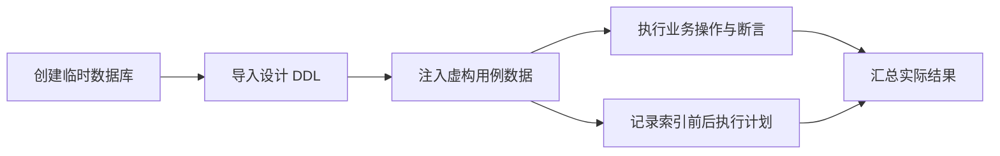

# 教务系统数据库测试与优化报告

数据库系统原理课程设计 · 第三阶段 · 2026 年 11 月 24 日复验

## 1. 测试对象与结论

以第二阶段提交 `68d64cc` 的[系统设计说明书](02-系统设计说明书.md)和[建表脚本](../sql/02-schema.sql)为基线。使用 MySQL 8.0.45 执行新生导入、课程排课、选退课、排考、成绩发布、评教及账户授权的数据库业务事务，并复测第三阶段索引迁移。

评审修正后，功能回归 **17 个场景全部通过**，总用时 39.922 秒，含两项新增的成绩流程回归。12 个独立连接争抢最后 1 个名额时，仅 1 个连接成功，排课计数、有效选课和选课日志各保留 1 条。并发测试另外验证同一学生同时申请两门冲突课程时只成功一门。管理员不限类型的待办首页查询在 120,000 条测试申请上，从扫描 24,000 条待办降到读取 50 条，30 次测量的中位耗时从 **32.283 ms 降到 0.949 ms**。

数据库事务由测试用例直接调用，使用虚构数据。课程要求的测试文档、自动注入数据、测试脚本和优化证据汇总于表 4。

课程依据：[测试阶段必做内容](../02-课程内容-必做内容-提交材料.png)、[评分标准](../02-评分标准.png)。

## 2. 实验环境、数据和命令

表 1 记录实验环境、样例规模和用例隔离方法。

*表 1　实验环境与测试数据*

| 项目 | 使用情况 |
|---|---|
| 运行环境 | 本地 Windows，MySQL Community Server 8.0.45，Connector/Python 9.7.0。原始基准用 Python 3.12.14，评审复验用 Python 3.11.9 |
| 数据库设置 | InnoDB、`utf8mb4`、缓冲池 128 MiB、UTC 连接时区、严格 SQL 模式。写事务使用 READ COMMITTED |
| 独立环境 | 新建的测试 MySQL 实例绑定本机回环地址。现有 MySQL80 服务继续运行 |
| 测试隔离 | 每个业务用例创建唯一命名的临时数据库，导入二阶段 DDL 和三阶段索引，装载数据并执行测试，结束时删除本次创建的库 |
| 功能数据 | [fixtures.py](../tests/fixtures.py) 提供 20 名虚构学生、3 名教师、2 个学期、2 个校区、4 间教室、8 个样例排课，以及账号、培养方案与成绩规则。业务用例在此基础上执行实际写入和查询 |
| 性能数据 | [benchmark.py](../tests/benchmark.py) 生成 8,000 个样例账号、120,000 条申请及对应明细。待审 24,000 条，信息变更和重修各 12,000 条。同一时间允许多条提交，以验证分页排序的稳定性 |

### 2.1 自动注入与测试步骤



*图 1　业务回归与性能实验均从临时数据库开始*

从仓库根目录在 PowerShell 执行以下命令。把连接参数指向供测试使用的 MySQL 实例，并使用可创建临时库的账户。测试套件会自行加载 SQL 和数据。

```powershell
python -m pip install -r tests/requirements.txt
$env:DB_TEST_HOST = '127.0.0.1'
$env:DB_TEST_PORT = '43683'
$dbTestCredential = Get-Credential -Message '测试 MySQL 实例'
$env:DB_TEST_USER = $dbTestCredential.UserName
$env:DB_TEST_PASSWORD = $dbTestCredential.GetNetworkCredential().Password
python -B -m unittest discover -s tests -p "test_workflows.py" -v
python -B tests/benchmark.py --rows 120000 --repeats 30
Remove-Item Env:DB_TEST_PASSWORD
```

MySQL 端通过事务和外键回滚非法写入，测试断言同时核对成功及失败后的业务数据。每次并发操作使用独立连接并在屏障处一起开始。性能测试需要支持 `EXPLAIN ANALYZE` 的 MySQL 8.0.18 或更新版本。

参考：[MySQL 8.0 EXPLAIN 文档](https://dev.mysql.com/doc/refman/8.0/en/explain.html)。

## 3. 核心业务执行与结果

主入口是 [test_workflows.py](../tests/test_workflows.py)。表 2 按业务顺序列出输入和观察结果。完整执行输出见[评审复跑日志](evidence/stage3-review-workflows.txt)，原始测试记录见[阶段测试日志](evidence/stage3-workflows.txt)。

*表 2　核心业务与约束测试结果*

| 场景 | 输入与操作 | 数据库观察 |
|---|---|---|
| S06 新生导入 | 批量导入 20 人，重放同批次，再提交同编号异内容和含不存在行政班的批次 | 同批次返回原结果。无效批次报 1452，学生仍为 20 人，失败批次和错误码保留在审计记录 |
| S01、S02、S05 学籍与信息变更 | 查询本人学籍；同一个旧值发起两条变更；教师尝试审批，管理员先审批其中一条 | 教师越权被拒绝，第一条生效一次，第二条原值过期被拒绝。其他学生数据保持原值 |
| K01–K03 基础数据 | 新建小学期与课程，更新培养方案；尝试替换为引用不存在课程的方案 | 仅小学期为当前学期；课程外键错误导致整次方案更新回滚，合法方案保留 |
| K03、K06、K07、K18 生成开课与名单 | 从培养方案生成班课、指定主讲、排课开放、学生选入，随后改变课程库学分 | 未安排在目标阶段的课程被拒绝。班课学分快照保留，只有该班教师读到名单，名单仅含业务所需字段 |
| K08、K08a 排课 | 用相同周次试排占用的教室、教师和行政班；测试小教室和超限周次，再排不相交的周次 | 各冲突正确返回原因，超容量和非法周次被拒绝，互不相交的周次可用同一教室 |
| K09、K10、K12、K16 选退课 | 操作窗口边界、班级适用范围、休学状态、重复课程、学分上限和跨校区同时段，随后退选及重选 | 非法请求被拒绝。幂等重试无额外计数，本人课表和选课结果随选退变化。重选沿用原选课记录并追加日志 |
| K10a 名额并发 | 12 个学生连接同时选只剩 1 个名额的排课 | 1 个成功、11 个满员，计数、有效选课和日志各 1 条 |
| K10a 学生并发 | 同一学生两个连接同时选上课时间重叠的两个排课 | 1 门成功、1 门因时间冲突被拒绝，两个班的成功人数合计为 1 |
| K11 预选抽签 | 三个预选志愿、其中一个撤回；以固定种子封轮并重放 | 封轮前计数为 0。剩余两个志愿得出 1 个中签、1 个落选，撤回者不参与，重放不重复写入 |
| K11 教务调整 | 越权尝试手工退选；满员补选；管理员先退一人再补一人 | 越权和满员被拒绝。合法调整后计数为 1，日志保留操作者、前后状态和原因 |
| E01–E06 排考与缓考 | 多考场分座，试排资源重复的考试，查询本人考试和监考，学生申请缓考后排入下一学期 | 排考冲突均被拒绝。本人的考试和监考分配可查。缓考审批后只把该生排入新场次，原成绩可按缓考标识发布 |
| G01–G06、G09–G10，K04–K05 成绩与学分 | 权重异常、批量越界、名单缺失、提交退回、审核发布；两份同版本更正及补考 | 越界批量整批回滚。发布前不可见。87.00 更新为 97.00 并记录原值和绩点，过期版本拒绝。补考后可查两次成绩并只计一次学分 |
| P01–P05 评教 | 按选课生成任务，尝试替他人提交、越界、漏答、超时及重复；关闭批次后计算汇总 | 非法输入被拒绝。样例总分 78.00，应评 2 人、实评 1 人，教师只能查本班汇总，输出中无学生标识或评语 |
| C01、A01、A02 账户及权限 | 新建账户、校验口令哈希、授予和撤回角色、修改密码并锁定 | 改密后旧密码失效；角色变更生效；锁定账户无法登录。用例覆盖数据库身份验证与业务授权 |
| DDL 约束与迁移 | 超额计数、无效外键及重复选课直接写入；查询迁移后的元数据 | 分别返回 3819、1452、1062。仍有 63 张 InnoDB 基表，新增待办索引由三列组成 |

### 3.1 实验边界

以上为数据库和测试用事务的集成验证。学校正式系统、网页会话、外部收费/招生接口和真实证件加密链路不在本轮实验环境内。学生信息更新用例使用虚构密文字节。调停课专项、重修缴费接口和成绩复核流转等一般业务此次采用第二阶段的设计作为后续扩展依据。性能数据为本机合成负载下单条查询的结果。

## 4. 实测问题与优化

### 4.1 评审复现的成绩流程问题

**截止后退回的登记单无法重提。** 在录入期保存并提交，管理员在截止时退回。基线事务允许退回，却在教师再次保存时返回 `GRADE_WINDOW_CLOSED`。修复后，以登记单的退回日志授权任课教师补正；普通未提交的草稿仍受截止时间约束。复验核对其他教师仍被拒绝，补正后登记单可重提与发布，学生查到更新后的 97.00 分。

**考查课退选留下草稿成绩。** 先录入其中一名学生的成绩并办理退选，再录齐其他学生的成绩。基线要求成绩行集合与当前名单完全相等，造成录齐后仍返回 `GRADE_INCOMPLETE`。修复后的提交事务先锁定排课、核对当前名单，确认剩余学生均录齐后再清理退选学生的成绩及分项。复验表明仍有学生未录时提交回滚，考查课发布后只有保留选课的学生能查到 87.00 分。

两条回归分别为 `test_grades_returned_after_deadline_can_be_resubmitted` 和 `test_assessment_submits_after_a_graded_student_drops`。两条在原实现上均报上述错误，修复后随完整套件通过。[评审复跑日志](evidence/stage3-review-workflows.txt)

### 4.2 管理员查看不限类型的待办列表

管理员待办列表允许按申请类型筛选，也允许查看全部待办。原组合索引 `ix_request_queue (state, request_type, requested_at, request_id)` 能服务指定类型的有序查询。不限类型时，`request_type` 位于状态和时间之间，索引中的不同类型各自有序，整体仍需要按时间和申请编号排序。基线执行计划显示查询扫描全部 24,000 条待审记录，排序后返回前 50 条。

```sql
SELECT request_id, request_type, applicant_id, requested_at
FROM request
WHERE state = 'PENDING'
ORDER BY requested_at, request_id
LIMIT 50;
```

### 4.3 增量迁移与同条件对比

[03-request-queue-index.sql](../sql/03-request-queue-index.sql) 新增 `ix_request_queue_time (state, requested_at, request_id)`。原索引继续用于按类型筛选。对同一库中的同一批数据先测量基线，再应用迁移并刷新统计信息，分别预热 5 次、测量 30 次。计时从 Python 发出 SQL 到接收全部 50 条结果。表 3 汇总两种查询的前后对比。

*表 3　管理员待办查询性能对比*

| 查询 | 顺序访问基线 → 迁移后 | 中位耗时 | P95 |
|---|---|---|---|
| 不限申请类型 | 读取 24,000 行并排序 → 按新索引读取 50 行 | 32.283 → 0.949 ms | 50.034 → 1.323 ms |
| 只看重修待办 | 两次均按原索引读取 50 行 | 0.943 → 0.934 ms | 1.149 → 1.390 ms |

不限类型查询中位耗时约为优化前的 1/34，两次各返回完全相同的有序结果。按类型的查询仍采用原索引，本次的延迟变化不作提速结论。新增二级索引会占用空间并增加申请写入维护成本，适用场景是有频繁不限类型待办读取的使用方式。完整计划、中位值、P95 和极值见[前后对比日志](evidence/stage3-benchmark.txt)。

参考：[MySQL ORDER BY 优化](https://dev.mysql.com/doc/refman/8.0/en/order-by-optimization.html)。

### 4.4 执行计划和迁移核对

下面摘录不限类型查询的实际执行计划节点，省略优化器的估算值和重复条件。比较的是执行时索引返回行数。

```text
Before
  Limit                         actual rows = 50
  Sort by requested_at, request_id
  Index lookup ix_request_queue actual rows = 24000

After
  Limit                              actual rows = 50
  Index lookup ix_request_queue_time actual rows = 50
```

在已选中的第二阶段数据库执行一次增量脚本即可添加该索引。空库先导入 `02-schema.sql`，再执行 `03-request-queue-index.sql`。基准程序可通过 `--baseline-only` 复查旧结构。

## 5. 提交材料

*表 4　复现实验所用文件*

| 材料 | 位置 |
|---|---|
| 测试执行入口 | [test_workflows.py](../tests/test_workflows.py)、[benchmark.py](../tests/benchmark.py) |
| 数据注入 | [fixtures.py](../tests/fixtures.py)，压力数据由 `benchmark.py` 同步生成 |
| 数据库附件 | [第二阶段建表 SQL](../sql/02-schema.sql)、[第三阶段索引迁移](../sql/03-request-queue-index.sql) |
| 原始验证证据 | [评审复跑日志](evidence/stage3-review-workflows.txt)、[阶段测试日志](evidence/stage3-workflows.txt)、[查询计划与性能日志](evidence/stage3-benchmark.txt) |
