# 教务系统需求分析文档

| 项目 | 内容 |
|---|---|
| 课程 | 数据库系统原理课程设计 |
| 场景 | 教务系统（只做与数据库相关的需求与设计，不实现系统） |
| 本组范围 | 学生信息管理、课程与选课管理、考试管理、成绩管理、评教管理 |
| 不做 | 毕设管理、教室管理、教师信息管理（教室、教师只作为外部基础数据引用） |
| 小组成员 | 韦祺振（2024211444）、（待填） |
| 版本 | v0.1，2026-11-17，需求检查点 |

**资料来源标记**
- **【实测】** 以学生身份浏览北邮本科教务系统（`jwgl.bupt.edu.cn/jsxsd`）的页面直接看到。逐页记录见 `01-学生端业务调研与需求分析.md`。
- **【资料】** 采用同一厂商教务系统（强智）的其他高校公开的教师端操作手册，来源见附录 A。
- **【推断】** 根据数据之间的依赖关系或业务常识推出，需要老师确认。

---

## 0. 本文与课程要求的对照

主体按《需求和数据库的关联》中的**六个问题**组织（第 2–7 节），每个问题最后都落到“对数据库设计的影响”。

| 课程要求 | 类型 | 本文位置 |
|---|---|---|
| 功能需求：系统参与角色 | 必做 | §2 |
| 功能需求：不同角色的功能（用例分析） | 必做 | §3.2–3.4 |
| 数据库：概念结构设计（实体、联系、主要属性） | 必做 | §3.6–3.8 |
| 流程分析合理，逻辑清晰，输入输出描述完整 | 评分标准 | §3.3、§4 |
| 用例完整覆盖核心功能需求 | 评分标准 | §3.1 用数据生命周期检查完整性 |
| 非功能需求：安全性、性能 | 选做 | §7 |
| 数据库：数据字典 | 选做 | §8 |

---

## 1. 范围

课程资料中的教务系统包含八个子系统。本组负责下面五个，其余三个只引用其数据。

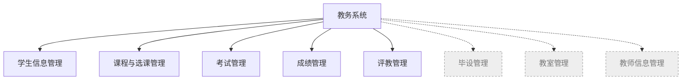

> 虚线框为本组不做的子系统。教室管理、教师信息管理的数据（教室、教师）在本系统中以**镜像表**的形式只读引用，见 §5。

---

## 2. 问题 1：系统业务主要是哪些人群在使用？——角色与权限

### 2.1 参与角色

| 角色 | 职责 | 数据范围 |
|---|---|---|
| **学生** | 查询本人学籍、课表、考试、成绩；选课；提交各类申请；评教 | 本人 |
| **任课教师** | 查看课表和名单；调停课申请；设置成绩构成、录入并提交成绩；处理复核；查看本人评教结果 | 本人所教的教学班 |
| **管理员** | 维护学期、课程、培养方案；开课、安排任课教师、排课；设置选课；排考；审核各类申请；控制成绩录入时间，审核并发布成绩，审批成绩更正；组织评教；管理账户、角色和权限 | 全校 |

> 现实中的教务管理分为学院教务、教务处、系统管理员等多个岗位，重修报名还要经过上课学院、开课学院两级审核【实测】。本设计把它们**合并为一个管理员角色**，多级审核简化为一次审核。
>
> 合并后管理员权限集中，用两条规则弥补：
> - **核心数据的修改必须有两方参与**：管理员不能直接改成绩，只能审批教师提交的更正申请；
> - **管理员的操作全部留痕**（操作日志、审核记录、成绩变更日志）。
>
> 权限按“权限点”而不是按角色写死（§2.3），以后要拆出学院教务等角色，只需新增角色并分配权限，不改表结构。

### 2.2 不同角色对同一数据的权限

课程资料以成绩为例：教务查询所有学生的成绩，教师查询、修改本人授课课程的成绩，学生查询本人选修课程的成绩。按同样的思路，把所有核心数据都过一遍（R 读，W 写，A 审核，— 无权）：

| 数据 | 学生 | 任课教师 | 管理员 |
|---|---|---|---|
| 学生基本信息 | R 本人（改须申请） | R 所教学生的姓名、学号、班级 | R W；A 修改申请 |
| 证件号、家庭成员 | R W 本人 | — | R（脱敏显示） |
| 课程、培养方案 | R | R | R W |
| 教学班、排课 | R | R 本人所教 | R W；A 调停课 |
| 选课记录 | R W 本人（开放期内） | R 本人所教班名单 | R W |
| 考试、监考安排 | R 本人 | R 本人监考 | R W |
| 成绩 | R 本人**已发布** | R W 本人所教（提交前） | R；A 审核发布、更正（**不能直接改**） |
| 评教记录 | W 本人 | R 本人**汇总**（看不到学生身份） | R 汇总 |
| 账户、角色、权限 | 改本人密码 | 改本人密码 | R W |

### 2.3 对数据库设计的影响

1. **RBAC 支撑表**：用户账户、角色、权限、用户—角色、角色—权限（见 §4.9 E-R 图）。虽然只有三个角色，仍然用权限点控制，便于以后拆分管理员。账户要关联学号或工号，“本人”“本人所教”这些数据范围都靠它计算。
2. **按角色设计视图**，例如：
   - `v_student_grade`：只含已发布的成绩，不含分项和审核信息；
   - `v_teacher_roster`：教学班名单，只含学号、姓名、班级，不含证件号、电话；
   - `v_teacher_eval_result`：评教汇总，不含任何学生标识。
3. MySQL 视图不能带参数。“只看本人”这一层由应用层或存储过程按会话身份过滤；数据库层按角色建账号，**只授予对应视图和存储过程的权限**，不授予基表权限。

---

## 3. 问题 2：不同人群要做什么业务？涉及哪些信息？信息之间有什么关联？

### 3.1 方法：用“数据生命周期”保证用例完整

学生端是实测的，但教师和管理员账号我们登不上。为了不漏用例，采用这个办法：**系统里的每一类数据，都必须有人创建、有人修改、有人读取。** 学生只读的数据（培养方案、课表、考试安排、成绩……），一定是别的角色在维护。把每类数据的增删改都找到负责的角色，就得到了教师和管理员的用例。

下表同时也是课程资料所说的**“操作清单”**：逻辑设计必须支持表中的每一个操作。（C 创建，R 读，U 改，D 删）

| 数据 | 学生 | 任课教师 | 管理员 | 产生 / 修改它的用例 |
|---|---|---|---|---|
| 学院、专业、学年学期、节次时间 | R | R | C R U D | K01 |
| 教师、教室（镜像） | R | R | C R U（同步） | A03 |
| 行政班、学生 | R 本人 | R | C R U | S06 新生导入；S05、S07 修改 |
| 家庭成员 | C R U D | | R | S03 |
| 信息变更申请 | C R | | R U（审核） | S02、S05 |
| 学籍异动 | R | | C R U | S07 |
| 课程 | R | R | C R U D | K02 |
| 培养方案、方案课程 | R | R | C R U D | K03 |
| 教学班 | R | R | C R U D | K06 |
| 授课（教学班—教师） | R | R | C R U D | K07 |
| 排课 | R | R | C R U D | K08；K20 调停课生效 |
| 调停课申请 | | C R | R U（审批） | K19、K20 |
| 选课轮次 | R | | C R U D | K09 |
| 选课记录 | C R U | R | C R U | K10 选退；K11 筛选、调整 |
| 重修报名、免听申请 | C R | | R U（审核） | K13、K15、K14 |
| 考试、考生安排 | R | R | C R U | E01 |
| 监考安排 | | R | C R U | E02 |
| 缓考申请 | C R | | R U（审核） | E05、E06 |
| 成绩登记单 | | U（提交） | C（开放录入）、U（审核发布） | G01、G04、G05 |
| 成绩构成（分项与比例） | | C R U D | R | G02 |
| 成绩、分项成绩 | R 本人已发布 | C R U（提交前） | R（只能通过更正审批修改） | G03；G10 |
| 复核申请 | C R | R U（处理） | R | G07、G08 |
| 成绩更正申请 | | C R | R U（审批） | G09、G10 |
| 绩点规则 | | | C R U D | G12 |
| 评价指标体系、指标 | | | C R U D | P01 |
| 评教批次 | R | | C R U D | P02 |
| 评价记录、指标得分 | C R 本人 | | R（匿名统计） | P03 |
| 评教结果汇总 | | R 本人 | C R | 批次结束时生成；P04、P05 |
| 账户、角色、权限 | U 本人密码 | U 本人密码 | C R U D | A01、A02 |
| 审核记录、选课日志、成绩变更日志、操作日志 | 系统自动 C | | R | 随业务操作自动写入；A04 |

**检查结论：** 每一类数据都至少有一个角色负责创建，没有“没人产生”的数据，也没有“只写不读”的数据。各角色的写操作也印证了 §2 的职责划分：学生只写“自己的申请、选课、评教”，教师只写“自己课程的成绩和调停课、更正申请”，管理员负责“全校级的计划、审核与发布”，但**成绩这一列管理员没有直接写权限**。

### 3.2 用例图

所有角色都有“C01 登录 / 修改密码”，图中省略。用例编号前缀：S 学生信息，K 课程与选课，E 考试，G 成绩，P 评教，A 系统管理。

**顶层用例图**

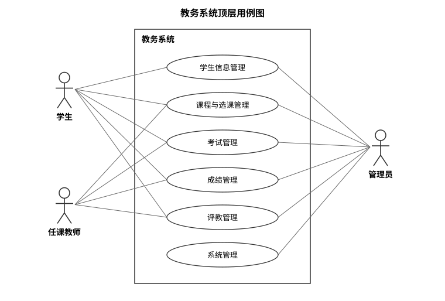

**学生**

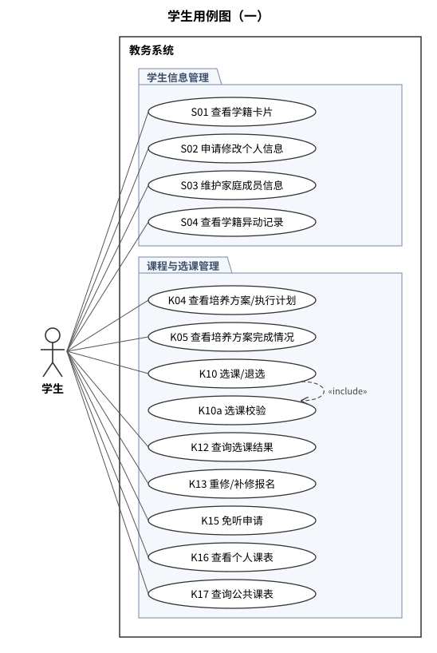

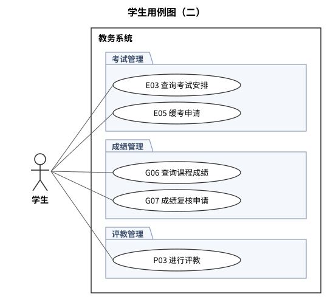

**任课教师**

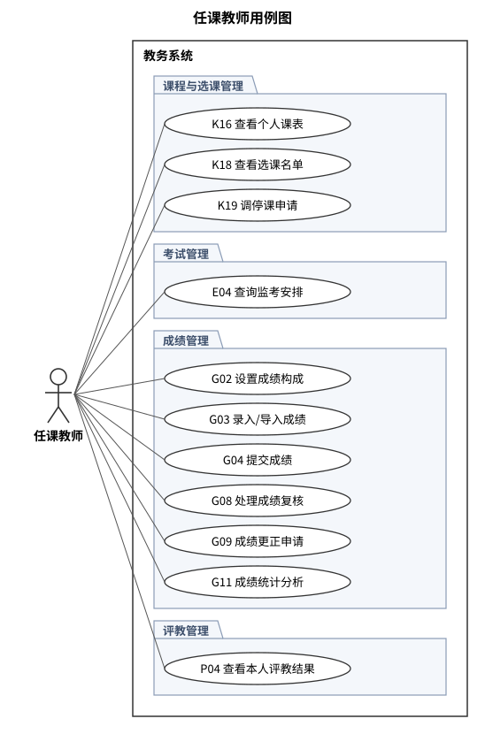

**管理员**

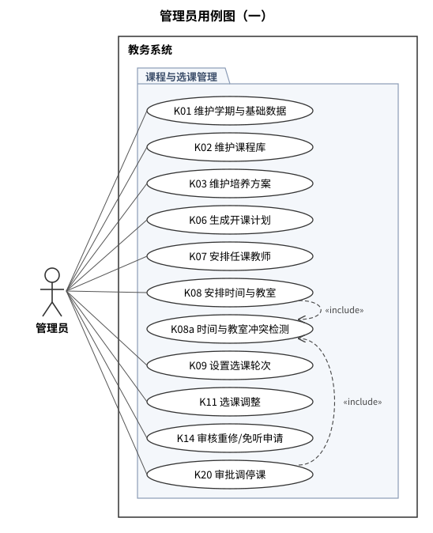

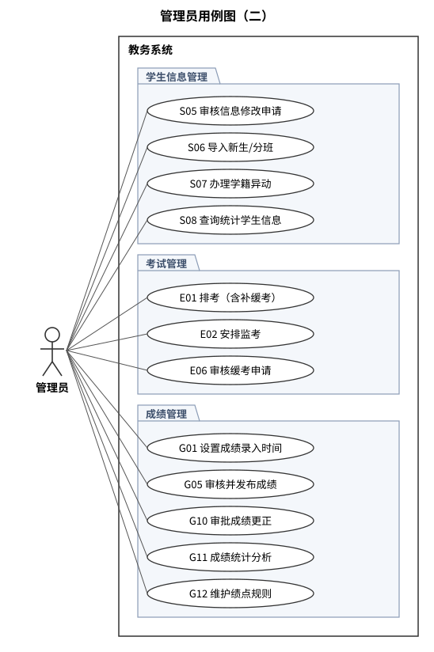

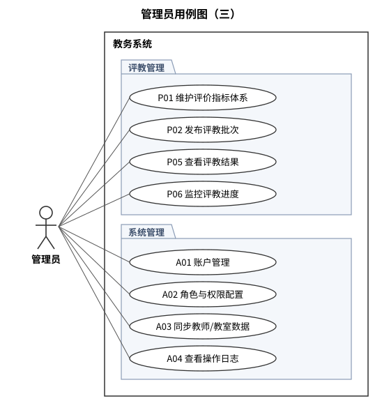

> 图片由 `diagrams/gen_usecase.mjs` 生成（`node gen_usecase.mjs --png` 同时输出 PNG，便于插入 Word）。改用例时改脚本里的数据再重新生成即可。

### 3.3 用例清单（含输入输出）

优先级：**核心** 必须在设计和测试中覆盖；一般；选做。

#### 学生信息管理

| 编号 | 用例 | 参与者 | 优先级 | 输入 | 输出 |
|---|---|---|---|---|---|
| S01 | 查看学籍卡片 | 学生 | 核心 | 无（当前用户） | 学籍卡片：基本信息 + 异动列表【实测】 |
| S02 | 申请修改个人信息 | 学生 | 核心 | 字段、新值 | 申请记录（待审） |
| S03 | 维护家庭成员信息 | 学生 | 选做 | 姓名、关系、证件类型、证件号、电话、是否在职【实测】 | 家庭成员列表 |
| S04 | 查看学籍异动记录 | 学生 | 一般 | 无 | 异动类别、新旧学院 / 专业 / 班级 / 状态、终审状态【实测】 |
| S05 | 审核信息修改申请 | 管理员 | 核心 | 申请编号、审核结果、意见 | 申请状态；通过时更新学生信息；审核记录 |
| S06 | 导入新生 / 分班 | 管理员 | 核心 | 招生系统导出的新生名单、分班方案 | 学生、行政班记录；导入批次 |
| S07 | 办理学籍异动 | 管理员 | 一般 | 学号、异动类别（休学 / 复学 / 转专业 / 退学等）、新专业 / 班级、原因 | 学籍异动记录；学生的班级、学籍状态随之更新 |
| S08 | 查询统计学生信息 | 管理员 | 一般 | 学院、专业、年级、状态等条件 | 学生名单、人数统计 |

#### 课程与选课管理

| 编号 | 用例 | 参与者 | 优先级 | 输入 | 输出 |
|---|---|---|---|---|---|
| K01 | 维护学期与基础数据 | 管理员 | 核心 | 学年学期、开学日期、周数；节次时间；学院、专业 | 学年学期、节次时间、学院、专业记录 |
| K02 | 维护课程库 | 管理员 | 核心 | 课程编号、名称、开课单位、学分、各类学时、考核方式、课程性质 | 课程记录 |
| K03 | 维护培养方案 | 管理员 | 核心 | 专业、年级、总学分要求；每门课的课程体系、课程属性、开设学期 | 培养方案、方案课程 |
| K04 | 查看培养方案 / 执行计划 | 学生 | 核心 | 无（按本人专业年级） | 各学期应修课程【实测】 |
| K05 | 查看培养方案完成情况 | 学生 | 核心 | 无 | 每门方案课程完成情况、已修学分 / 要求学分【实测】 |
| K06 | 生成开课计划 | 管理员 | 核心 | 学期；执行计划；行政班 | 教学班（课程、学期、课序号、容量、面向班级） |
| K07 | 安排任课教师 | 管理员 | 核心 | 教学班、教师、主讲 / 助教 | 授课记录 |
| K08 | 排课 | 管理员 | 核心 | 教学班、周次、星期、节次、教室 | 排课记录；冲突提示 |
| K08a | 时间与教室冲突检测（被 K08、K20 包含） | — | 核心 | 待排的时间地点 | 冲突列表：教师冲突、行政班冲突、教室冲突、座位不足 |
| K09 | 设置选课轮次与规则 | 管理员 | 核心 | 学期、轮次名称、选课模式（抽签 / 即选即得【资料】）、起止时间、适用范围、学分上限 | 选课轮次 |
| K10 | 选课 / 退选 | 学生 | 核心 | 轮次、教学班 | 成功或失败原因；已选列表 |
| K10a | 选课校验（被 K10 包含） | — | 核心 | 学生已选课程、教学班容量 | 重复选课、时间冲突、已满、超学分上限的判定 |
| K11 | 选课筛选与调整 | 管理员 | 核心 | 轮次；超额教学班 | 中签 / 落选结果；手工补选、退选 |
| K12 | 查询选课结果 | 学生 | 核心 | 学年学期 | 已选课程、教师、学分、修读类型、是否免听【实测】 |
| K13 | 重修 / 补修报名 | 学生 | 一般 | 课程、报名类别、替代课程 | 报名记录、审核进度、缴费状态【实测】 |
| K14 | 审核重修 / 免听申请 | 管理员 | 一般 | 申请、审核结果 | 申请状态；审核记录；重修通过后取得资格，免听通过后更新选课记录 |
| K15 | 免听申请 | 学生 | 选做 | 教学班、理由 | 申请记录 |
| K16 | 查看个人课表 | 学生、任课教师 | 核心 | 学期、周次 | 星期 × 节次课表【实测】 |
| K17 | 查询公共课表 | 学生（及其他角色） | 一般 | 学期、班级 / 教师 / 教室 / 课程 | 课表【实测】 |
| K18 | 查看教学班名单 | 任课教师 | 核心 | 教学班 | 学号、姓名、行政班、修读类型 |
| K19 | 调停课申请 | 任课教师 | 一般 | 教学班；调课类型（整体调课 / 部分调课 / 停课 / 变更教师）；原周次、新周次、新时间、新地点、新教师；原因【资料】 | 调停课申请（待审） |
| K20 | 审批调停课 | 管理员 | 一般 | 申请、审批结果 | 申请状态；审核记录；通过时修改排课，学生课表随之变化 |

#### 考试管理

| 编号 | 用例 | 参与者 | 优先级 | 输入 | 输出 |
|---|---|---|---|---|---|
| E01 | 排考（含补缓考） | 管理员 | 核心 | 学期、学期类别（期初 / 期中 / 期末）；需考试的教学班；选课名单；教室及考试座位数 | 考试、考生安排（考场、座位号、准考证号） |
| E02 | 安排监考 | 管理员 | 一般 | 考试、考场、教师 | 监考安排 |
| E03 | 查询考试安排 | 学生 | 核心 | 学年学期、学期类别 | 考试时间、校区、考场、座位号、准考证号等【实测】 |
| E04 | 查询监考安排 | 任课教师 | 一般 | 学期 | 监考时间、考场、课程 |
| E05 | 缓考申请 | 学生 | 一般 | 考试、理由、证明 | 申请记录 |
| E06 | 审核缓考申请 | 管理员 | 一般 | 申请、审核结果 | 申请状态；通过时标记考生“缓考”，进入补缓考名单 |

#### 成绩管理

| 编号 | 用例 | 参与者 | 优先级 | 输入 | 输出 |
|---|---|---|---|---|---|
| G01 | 设置成绩录入时间 | 管理员 | 核心 | 学期、考试性质（正考 / 补考）、开始时间、结束时间 | 各教学班的成绩登记单（未录入） |
| G02 | 设置成绩构成 | 任课教师 | 核心 | 记分制；分项（平时 / 期中 / 期末）及比例【资料】 | 成绩构成 |
| G03 | 录入 / 导入成绩 | 任课教师 | 核心 | 每名学生的分项成绩、成绩标识（违纪 / 缺考 / 舞弊 / 取消考试资格【资料】）；或 Excel 模板 | 分项成绩、总评、绩点；可暂存 |
| G04 | 提交成绩 | 任课教师 | 核心 | 成绩登记单 | 登记单状态“已提交”，教师不能再改 |
| G05 | 审核并发布成绩 | 管理员 | 核心 | 登记单、审核结果、意见 | 通过：登记单“已发布”，学生可见；退回：回到“录入中” |
| G06 | 查询课程成绩 | 学生 | 核心 | 学期、课程性质、显示方式（最好 / 全部）【实测】 | 成绩、成绩标识、学分、绩点等【实测】 |
| G07 | 成绩复核申请 | 学生 | 一般 | 成绩、成绩项目、理由【实测】 | 复核申请 |
| G08 | 处理成绩复核 | 任课教师 | 一般 | 复核申请、处理结果 | 维持原成绩，或发起成绩更正 |
| G09 | 成绩更正申请 | 任课教师 | 一般 | 成绩、新成绩、原因 | 更正申请 |
| G10 | 审批成绩更正 | 管理员 | 一般 | 更正申请、审批结果 | 通过时修改成绩并写成绩变更日志 |
| G11 | 成绩统计分析 | 任课教师、管理员 | 一般 | 范围（本人课程 / 全校）、学期 | 分数段分布【资料】、平均分、不及格率、学业预警名单 |
| G12 | 维护绩点规则 | 管理员 | 一般 | 记分制、分数段或等级、绩点 | 绩点规则 |

#### 评教管理

| 编号 | 用例 | 参与者 | 优先级 | 输入 | 输出 |
|---|---|---|---|---|---|
| P01 | 维护评价指标体系 | 管理员 | 一般 | 指标体系名称；每条指标的内容、权重、满分 | 指标体系、指标 |
| P02 | 发布评教批次 | 管理员 | 一般 | 学年学期、评价分类、批次名称、起止时间【实测】、指标体系 | 评教批次；按选课记录生成待评列表 |
| P03 | 进行评教 | 学生 | 一般 | 教学班—教师、每项指标得分、文字意见 | 评价记录 |
| P04 | 查看本人评教结果 | 任课教师 | 一般 | 批次 | 本人各教学班的参评人数、平均分、各指标得分（不含学生身份） |
| P05 | 查看评教结果 | 管理员 | 一般 | 批次、学院 | 汇总、排名、参评率 |
| P06 | 监控评教进度 | 管理员 | 选做 | 批次 | 各学院、班级的参评率 |

#### 系统管理

| 编号 | 用例 | 参与者 | 优先级 | 输入 | 输出 |
|---|---|---|---|---|---|
| C01 | 登录 / 修改密码 | 所有角色 | 核心 | 账号、密码 | 登录态；按角色进入对应首页 |
| A01 | 账户管理 | 管理员 | 核心 | 账号、关联学号 / 工号、状态 | 账户 |
| A02 | 角色与权限配置 | 管理员 | 核心 | 角色、权限、用户—角色 | 角色、权限分配 |
| A03 | 同步教师 / 教室数据 | 管理员 | 一般 | 教师信息管理、教室管理子系统的数据 | 教师、教室镜像表 |
| A04 | 查看操作日志 | 管理员 | 一般 | 时间、用户、操作类型 | 日志列表 |

### 3.4 核心用例详述

#### K08 排课（管理员）

| 项目 | 内容 |
|---|---|
| 前置条件 | 开课计划已生成（K06），任课教师已安排（K07）。 |
| 基本流 | 1. 选择一个待排的教学班。<br/>2. 指定周次、星期、起止节次、教室。<br/>3. 系统做冲突检测（K08a）：同一时间段内，同一**教师**、同一**行政班**、同一**教室**不能被占用两次；教室座位数不能小于教学班容量。<br/>4. 无冲突则写入排课；有冲突则给出冲突列表，返回第 2 步。 |
| 输入 | 教学班、周次、星期、起止节次、教室 |
| 输出 | 排课记录；冲突列表 |
| 涉及数据 | 读：教学班、授课、面向班级、排课、教室；写：排课 |
| 说明 | 现有系统把上课时间显示为“第 3-11,13,15-18 周 1[03-04]节”【实测】。“同一时间段”是指**周次有交集、星期相同、节次有重叠**。 |

#### K10 选课 / 退选（学生）

| 项目 | 内容 |
|---|---|
| 前置条件 | 处于某个选课轮次的开放时间内；学籍状态为在读。 |
| 基本流 | 1. 系统列出开放的轮次【实测】。<br/>2. 学生选择教学班。<br/>3. 选课校验（K10a）：重复选课、时间冲突、容量、学分上限。<br/>4. 通过则写入选课记录，教学班已选人数 +1，写选课日志。<br/>5. 开放期内可退选，已选人数 −1。 |
| 备选流 | 抽签模式下第 4 步只记为“已预选”，不占名额，轮次结束后由 K11 统一抽签。 |
| 输入 | 学号（会话）、轮次、教学班 |
| 输出 | 成功或失败原因；已选列表 |
| 涉及数据 | 读：选课轮次、教学班、排课、选课记录；写：选课记录、教学班、选课日志 |

#### G02–G04 设置构成、录入、提交成绩（任课教师）

| 项目 | 内容 |
|---|---|
| 前置条件 | 管理员已开放该学期的成绩录入（G01），当前时间在录入时间窗内。 |
| 基本流 | 1. 选择教学班，进入成绩登记单。<br/>2. 设置记分制和成绩构成，例如平时 30%、期末 70%；各分项比例之和必须为 100%【资料】。<br/>3. 逐个学生录入分项成绩，或下载 Excel 模板导入（追加 / 覆盖）【资料】。特殊情况选择成绩标识：违纪、缺考、舞弊、取消考试资格【资料】。<br/>4. 系统按比例计算总评，再按绩点规则换算绩点。<br/>5. 可以暂存，系统也定时自动保存【资料】。<br/>6. 核对无误后提交。提交后教师不能再修改，只能走成绩更正（G09）【资料】。 |
| 输入 | 成绩构成；每名学生的分项成绩和成绩标识 |
| 输出 | 分项成绩、总评、绩点；登记单状态变为“已提交” |
| 涉及数据 | 读：选课记录（名单）、绩点规则；写：成绩构成、成绩、分项成绩、成绩登记单 |
| 说明 | 有的学校规定先改比例会清空已录入的成绩【资料】，所以构成应在录入前确定。 |

#### G05 审核并发布成绩（管理员）

| 项目 | 内容 |
|---|---|
| 基本流 | 1. 管理员查看已提交的登记单（含分数段分布），审核通过或退回。<br/>2. 退回时登记单回到“录入中”，教师修改后重新提交。<br/>3. 审核通过即发布，学生可见。 |
| 输入 | 登记单、审核结果、意见 |
| 输出 | 登记单状态；审核记录；学生端可见的成绩 |
| 说明 | 管理员只能“通过”或“退回”，**不能直接修改**任何一条成绩。 |

#### E01 排考（管理员）

| 项目 | 内容 |
|---|---|
| 基本流 | 1. 选择学期和学期类别（期末；补缓考为下学期的期初）【实测】。<br/>2. 取出考核方式为“考试”的教学班及其选课名单；补缓考取出缓考通过和需要补考的学生。<br/>3. 为每场考试安排时间，按考试座位数分配考场，生成座位号和准考证号。<br/>4. 约束：同一学生同一时间只能有一场考试；考场人数不超过考试座位数。<br/>5. 发布后学生和教师可查询（E03、E04）。 |
| 输入 | 教学班、选课名单、缓考名单、教室 |
| 输出 | 考试、考生安排 |

#### K19–K20 调停课（任课教师 → 管理员）

| 项目 | 内容 |
|---|---|
| 基本流 | 1. 教师选择教学班和调课类型：整体调课、部分调课、停课、变更教师【资料】。<br/>2. 部分调课要填写原周次和新周次；变更教师要选择新教师【资料】。<br/>3. 系统列出可用时间和可用教室（已检测教师、学生、教室冲突，并考虑座位数）【资料】。<br/>4. 保存并送审。审核通过前可以撤回【资料】。<br/>5. 管理员审批，审批时再做一次冲突检测（K08a）；通过后修改排课，学生课表随之变化（学生端“调停课查询”【实测】）。 |
| 输入 | 教学班、调课类型、原 / 新周次、新时间、新地点、新教师、原因 |
| 输出 | 调停课申请及审核记录；修改后的排课 |

#### P03 进行评教（学生）

| 项目 | 内容 |
|---|---|
| 前置条件 | 有一个处于开放时间内的评教批次（P02）【实测：学生端列表有学年学期、评价分类、评价批次、开始时间、结束时间】。 |
| 基本流 | 1. 系统按本人本学期的选课记录列出待评的“教学班—教师”。<br/>2. 学生逐条指标打分，可填写文字意见。<br/>3. 提交后不能修改。同一批次内同一“教学班—教师”只能评一次。 |
| 输出 | 评价记录、指标得分 |
| 说明 | 教师只能看到汇总结果，**不能看到是谁评的**（§9 第 11 条）。 |

> 学生端的 S02 申请修改个人信息、E03 查询考试安排、G06 查询课程成绩，其页面字段和观察结论见 `01-学生端业务调研与需求分析.md` 第 4.3 节。

### 3.5 实体清单

英文名会作为后续逻辑设计的表名。

| 模块 | 实体（英文名） | 主要属性 | 来源 |
|---|---|---|---|
| 基础 | 学院 `department` | 学院代码、名称 | 实测 |
| | 专业 `major` | 校内专业代码、名称、部颁专业代码 / 名称、学制、所属学院 | 实测 |
| | 行政班 `admin_class` | 班级号、年级、专业 | 实测 |
| | 学年学期 `term` | 学年学期代码、开学日期、周数、是否当前学期 | 实测 + 推断 |
| | 节次时间 `period_time` | 节次模式（校区）、节次、开始时间、结束时间 | 实测 |
| | 教师（镜像）`teacher` | 工号、姓名、所属学院、职称 | 推断 |
| | 教室（镜像）`classroom` | 教室编号、教学楼、校区、座位数、考试座位数 | 实测 + 推断 |
| 学生信息 | 学生 `student` | 学号、姓名、性别、证件号、出生日期、民族、籍贯、政治面貌、生源地、考生号、入学日期、预计毕业日期、电话、邮箱、学籍状态、行政班 | 实测 |
| | 家庭成员 `family_member` | 学号、序号、姓名、关系、证件类型、证件号、电话、是否在职 | 实测 |
| | 学籍异动 `status_change` | 异动编号、学号、异动类别、日期、原 / 新班级与学籍状态、终审状态 | 实测 |
| | 信息变更申请 `info_change_req` | 申请编号、学号、申请时间、审核状态 | 实测 |
| | 信息变更明细 `info_change_item` | 申请编号、修改字段、原值、新值 | 实测 + 推断 |
| 课程与选课 | 课程 `course` | 课程编号、名称、开课单位、学分、各类学时、考核方式、课程性质 | 实测 |
| | 培养方案 `program` | 方案编号、专业、年级、总学分要求 | 实测 |
| | 方案课程 `program_course` | 方案、课程、课程体系、课程属性、开设学期 | 实测 |
| | 教学班 `section` | 开课编号、课程、学期、课序号、校区、容量、已选人数、状态 | 实测 + 推断 |
| | 授课 `section_teacher` | 教学班、教师、角色（主讲 / 助教） | 推断 |
| | 面向班级 `section_class` | 教学班、行政班 | 实测 |
| | 排课 `schedule` | 教学班、周次、星期、起止节次、教室 | 实测 |
| | 调停课申请 `reschedule_req` | 申请编号、教学班、教师、调课类型、原 / 新周次、新时间、新教室、新教师、原因、状态 | 资料 |
| | 选课轮次 `selection_round` | 轮次编号、学期、名称、模式、起止时间、适用范围、学分上限 | 实测 + 资料 |
| | 选课记录 `enrollment` | 学号、教学班、轮次、修读类型、是否免听、状态、选课时间 | 实测 |
| | 重修报名 `retake_req` | 学号、课程、学期、报名类别、替代课程、两级院审、是否取得资格、是否缴费 | 实测 |
| | 免听申请 `exempt_req` | 学号、教学班、理由、状态 | 实测 + 推断 |
| 考试 | 考试 `exam` | 考试编号、教学班、学期类别、考试性质、时间、考试方式 | 实测 |
| | 考生安排 `exam_seat` | 考试、学号、考场、座位号、准考证号、是否缓考 | 实测 |
| | 监考安排 `invigilation` | 考试、考场、教师、角色（主监考 / 监考） | 推断 |
| | 缓考申请 `deferral_req` | 申请编号、学号、考试、理由、证明材料、状态 | 实测 |
| 成绩 | 成绩登记单 `grade_sheet` | 登记单编号、教学班、考试性质、记分制、录入起止时间、状态、提交时间 | 资料 |
| | 成绩构成 `grade_component` | 登记单、分项名称、比例 | 资料 |
| | 成绩 `grade` | 成绩编号、登记单、学号、总评、成绩标识、绩点、学分快照 | 实测 + 资料 |
| | 分项成绩 `grade_item` | 成绩、分项名称、分数 | 实测 + 资料 |
| | 复核申请 `review_req` | 申请编号、成绩、复核项目、理由、状态、处理结果 | 实测 |
| | 成绩更正申请 `correction_req` | 申请编号、成绩、教师、原成绩、新成绩、原因、状态、来源复核申请 | 资料 + 推断 |
| | 绩点规则 `gpa_rule` | 记分制、分数下限 / 上限或等级、绩点 | 推断 |
| 评教 | 评价指标体系 `eval_scheme` | 体系编号、名称 | 推断 |
| | 评价指标 `eval_indicator` | 指标编号、体系、内容、权重、满分、序号 | 推断 |
| | 评教批次 `eval_batch` | 批次编号、学期、评价分类、名称、起止时间、指标体系、状态 | 实测 |
| | 评价记录 `evaluation` | 记录编号、批次、学号、教学班、教师、总分、文字意见、提交时间 | 推断 |
| | 指标得分 `eval_answer` | 评价记录、指标、得分 | 推断 |
| | 评教结果汇总 `eval_result` | 批次、教学班、教师、应评人数、参评人数、平均分 | 推断 |
| 系统 | 用户账户 `user_account`、角色 `role`、权限 `permission`、用户—角色 `user_role`、角色—权限 `role_permission` | 见 §4.6 | 推断 |
| | 审核记录 `approval_log`、选课日志 `enroll_log`、成绩变更日志 `grade_log`、操作日志 `operation_log` | 见 §4.6 | 推断 |

### 3.6 概念结构：总体 E-R 图

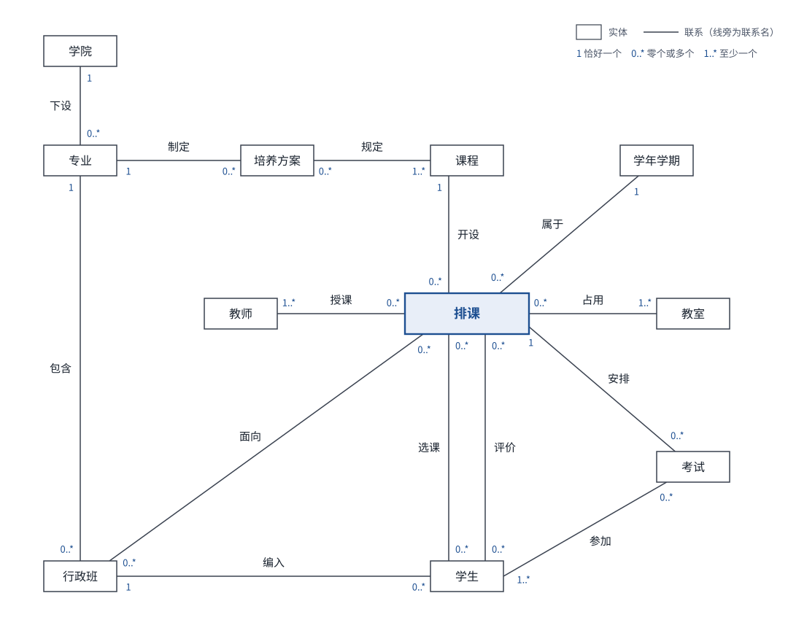

排课（`section`）包含课程、学期、课序号和容量等开课属性。排课通过占用联系关联教室，联系上的周次、星期和节次共同形成上课安排（`schedule`）。分模块图使用相同的表标识。

授课允许一份排课由多位教师协作。每条授课关系指定一份排课和一位教师，记录主讲或助教职责。学生评价针对自己选修的排课中的具体教师，按评教批次分别提交。主要实体属性见 §3.7，关系表映射见[系统设计说明书 §4.1](02-系统设计说明书.md#41-从概念-e-r-模型到关系模式)。

### 3.7 分模块 E-R 图

#### 基础数据与学生信息

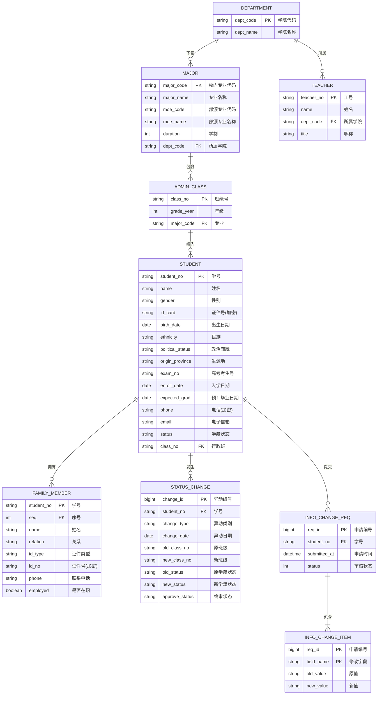

#### 课程、培养方案、开课与排课

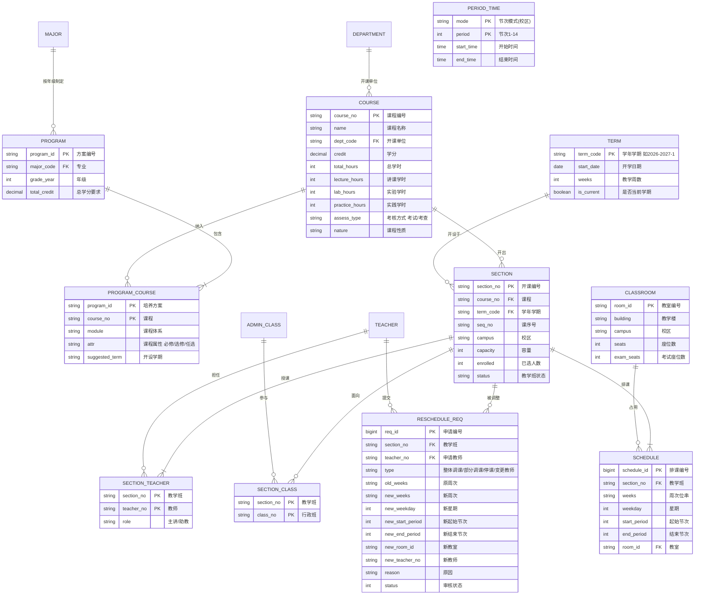

#### 选课、重修与免听

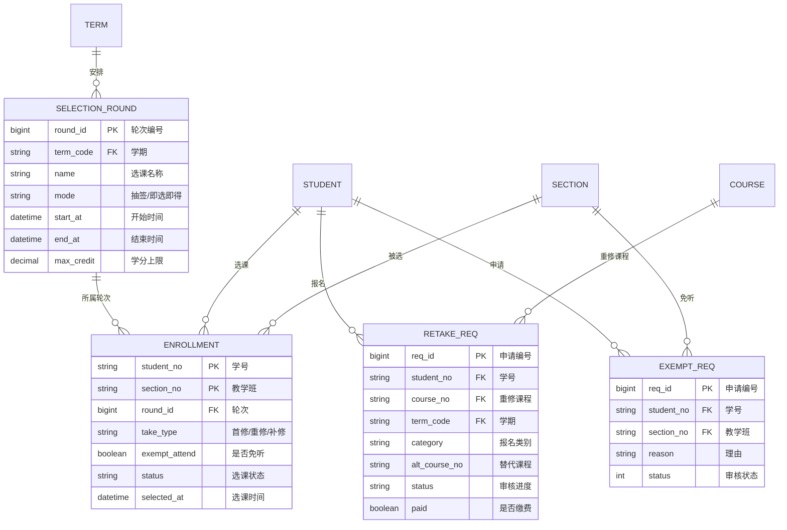

#### 考试

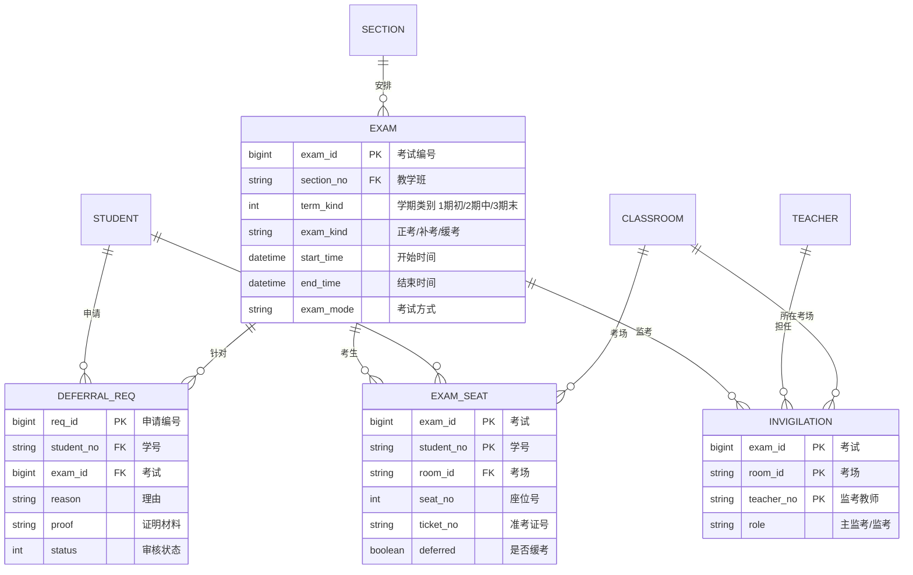

#### 成绩

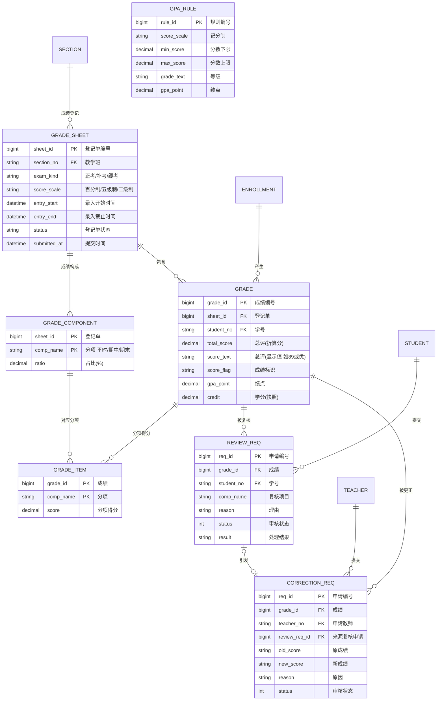

#### 评教

被评价的对象是“某个教学班的某位教师”，也就是“授课”这个联系本身。所以评价记录关联的是 `SECTION_TEACHER`，而不是单独的教学班或教师（把联系当作实体参与另一个联系）。

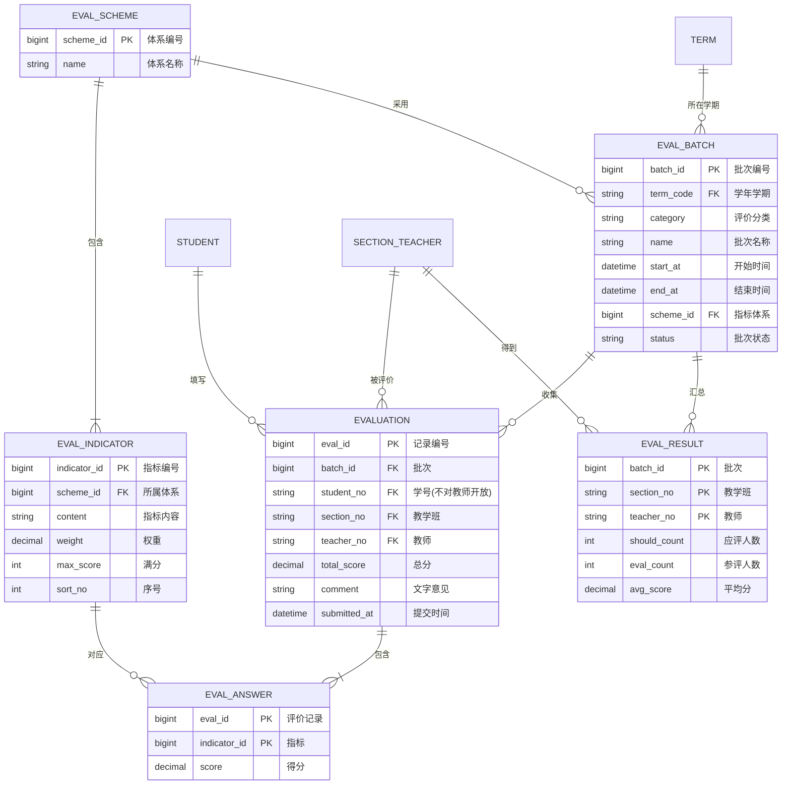

### 3.8 主要联系说明

| 实体 A | 实体 B | 联系 | 基数 | 联系上的属性 / 说明 |
|---|---|---|---|---|
| 学院 | 专业 | 下设 | 1 : N | |
| 专业 | 行政班 | 包含 | 1 : N | |
| 行政班 | 学生 | 编入 | 1 : N | 换班的历史记录在学籍异动里 |
| 专业 | 培养方案 | 制定 | 1 : N | 每个年级一套 |
| 培养方案 | 课程 | 包含 | M : N | **课程体系、课程属性、开设学期**：同一门课对不同专业可以是必修或选修 |
| 课程 | 教学班 | 开出 | 1 : N | 同学期可开多个班（课序号不同） |
| 教学班 | 教师 | 授课 | M : N | **角色**（主讲 / 助教）；该联系还是评教的对象 |
| 教学班 | 行政班 | 面向 | M : N | 实测“上课班级：[2024211315-2024211319]班” |
| 教学班 | 教室 | 排课 | M : N | **周次、星期、起止节次**（转为排课实体） |
| 学生 | 教学班 | 选课 | M : N | **轮次、修读类型、是否免听、状态、选课时间**（转为选课记录实体） |
| 教学班 | 成绩登记单 | 成绩登记 | 1 : N | 正考一张，补考 / 缓考各一张 |
| 选课记录 | 成绩 | 产生 | 1 : N | 正考一条，补考 / 缓考再各一条 |
| 成绩 | 成绩构成 | 分项得分 | M : N | **分数**（转为分项成绩实体） |
| 考试 | 学生 | 参加 | M : N | **考场、座位号、准考证号、是否缓考**（转为考生安排实体） |
| 考试 | 教师 | 监考 | M : N | **考场、角色**（转为监考安排实体） |
| 学生 | 授课 | 评价 | M : N | **批次、总分、文字意见、提交时间**（转为评价记录实体） |
| 评价记录 | 评价指标 | 打分 | M : N | **得分**（转为指标得分实体） |

---

## 4. 问题 3：业务有怎样的操作流程？——数据如何被创建、修改、流转、保存

### 4.1 一学期的全局业务流程

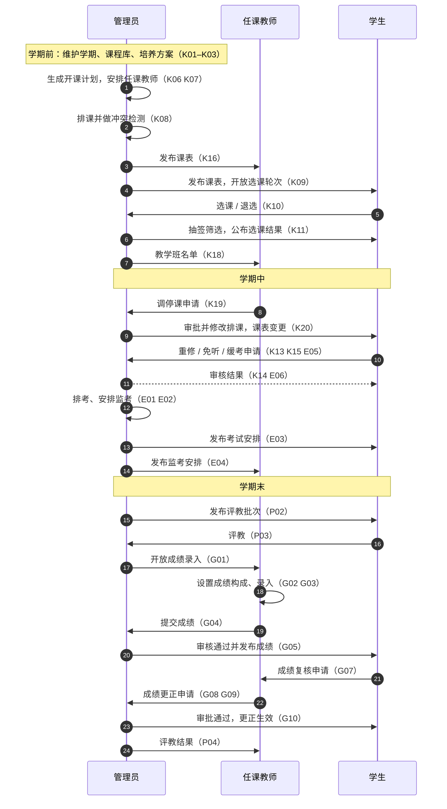

### 4.2 开课与排课

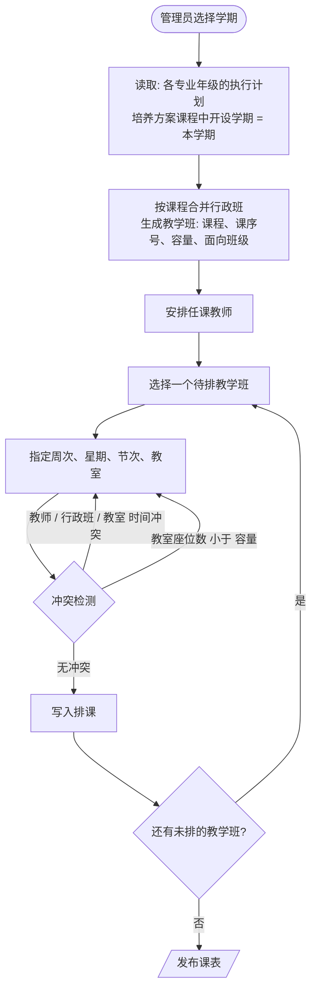

| 步骤 | 输入数据 | 输出 / 写入数据 |
|---|---|---|
| 生成开课计划 | 培养方案、方案课程、行政班、学期 | 教学班、面向班级 |
| 安排教师 | 教学班、教师（镜像） | 授课 |
| 冲突检测 | 已有排课（同周次交集、同星期、节次重叠）、授课、面向班级、教室座位数 | 冲突列表 |
| 写入排课 | 教学班、周次、星期、节次、教室 | 排课 |

### 4.3 选课（含学生校验和管理员筛选）

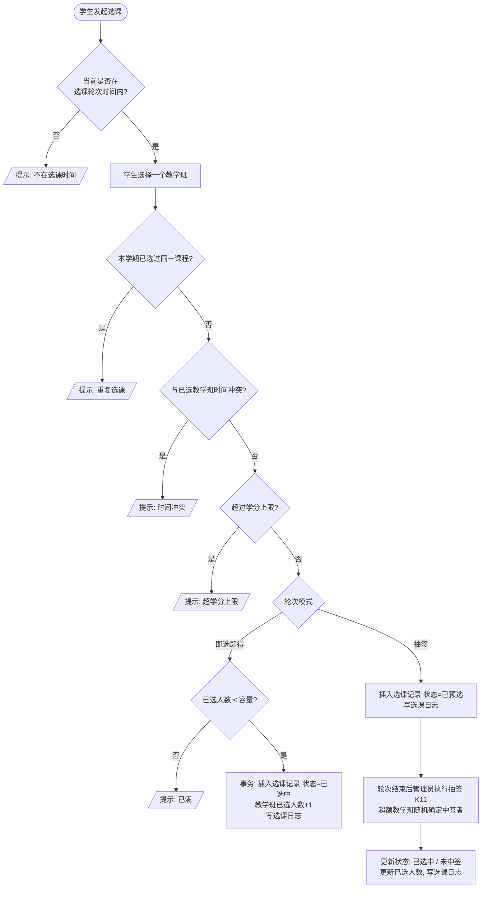

### 4.4 成绩：录入、审核、发布、更正

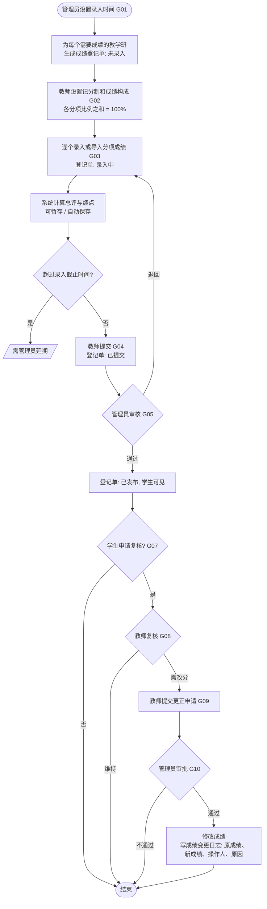

| 步骤 | 输入数据 | 输出 / 写入数据 |
|---|---|---|
| 开放录入 | 教学班、考试性质、录入时间 | 成绩登记单 |
| 设置构成 | 记分制、分项与比例 | 成绩构成 |
| 录入 | 选课名单、分项成绩、成绩标识、绩点规则 | 成绩、分项成绩 |
| 提交 / 审核 / 发布 | 登记单 | 登记单状态、审核记录 |
| 更正 | 复核申请、新成绩 | 更正申请、成绩、成绩变更日志 |

### 4.5 排考

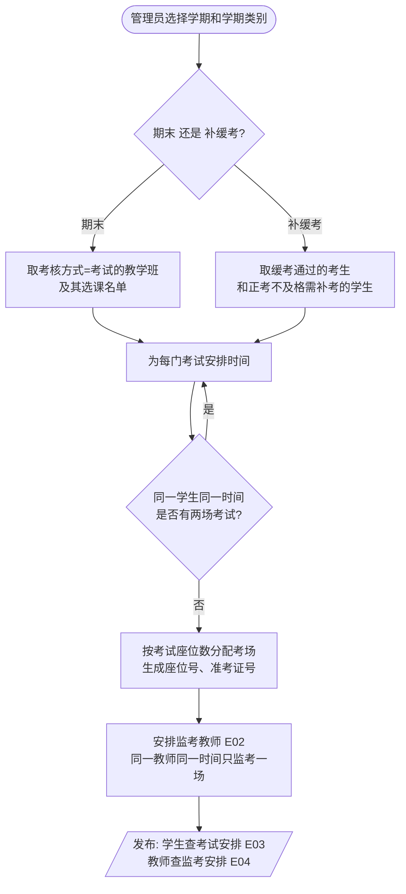

### 4.6 申请审核的通用流程

学籍信息修改、重修、免听、缓考、调停课、成绩复核、成绩更正，都是同一个模式：学生或教师提出，管理员（复核由任课教师）审核一次。

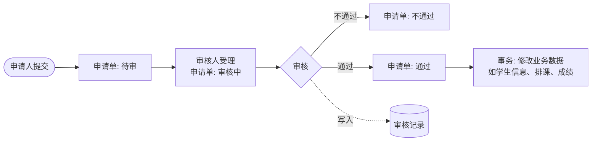

| 申请 | 申请人 | 审核人 | 通过后修改的数据 |
|---|---|---|---|
| 信息修改 | 学生 | 管理员 | 学生 |
| 重修报名 | 学生 | 管理员（现实中为上课学院、开课学院两级【实测】），再由财务确认缴费 | 选课记录（修读类型=重修） |
| 免听 | 学生 | 管理员 | 选课记录.是否免听 |
| 缓考 | 学生 | 管理员 | 考生安排.是否缓考；补缓考名单 |
| 成绩复核 | 学生 | 任课教师 | 无（需要改分时由教师发起成绩更正） |
| 调停课 | 教师 | 管理员 | 排课 |
| 成绩更正 | 教师 | 管理员 | 成绩；成绩变更日志 |

> 学籍异动由管理员直接办理（S07），不经过申请—审核，但同样写入学籍异动记录和操作日志。

### 4.7 评教

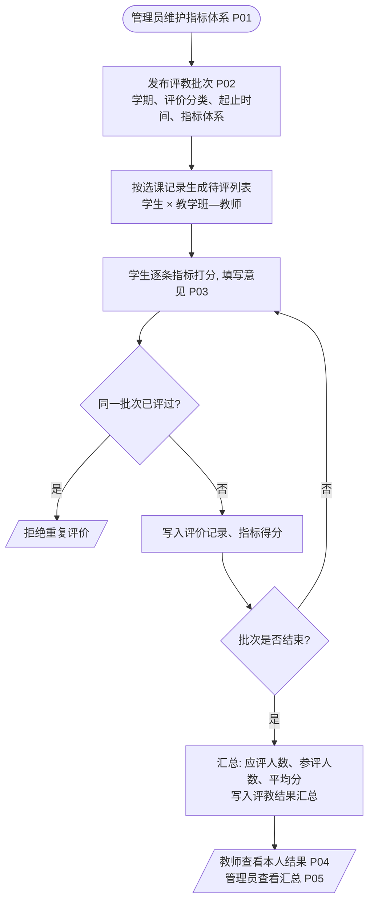

### 4.8 状态图

#### 教学班

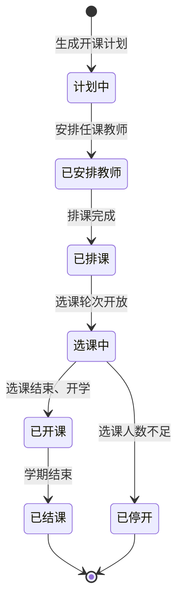

#### 成绩登记单

前三个状态参考了“未录入 / 录入中 / 已确认”【资料】，后面加上了审核发布。

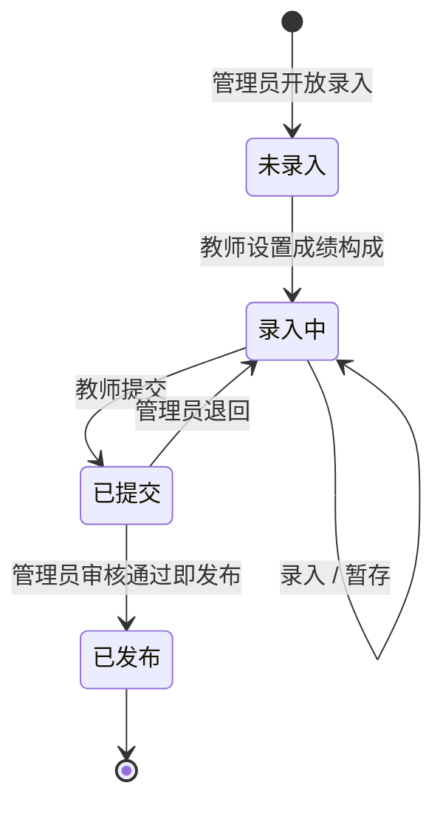

#### 申请单（各类申请共用）

缓考申请的筛选条件【实测】：待审、审核中、通过、不通过（页面内部编码 3、2、1、0）。

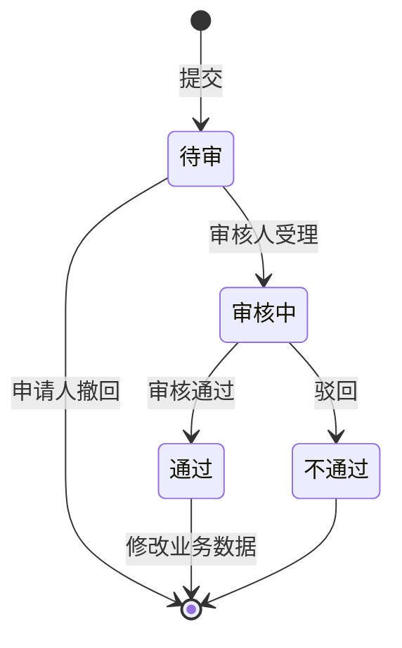

#### 选课记录

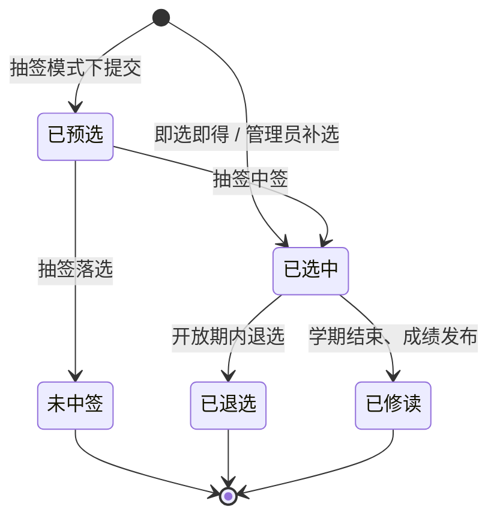

#### 评教批次

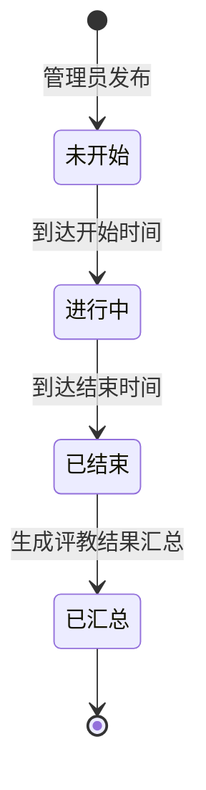

### 4.9 状态与历史的数据库支撑

课程资料指出两点：**要为状态变化设计字段；要为状态变化设计额外的表记录历史轨迹。**

| 有状态的数据 | 状态字段 | 为什么要留历史 | 历史表 |
|---|---|---|---|
| 学生 | 学籍状态、班级 | 转专业、休学后要能查出原来是什么 | 学籍异动（本身就是学生的历史） |
| 教学班 | 教学班状态 | 停开要能追溯原因 | 操作日志 |
| 排课 | — | 调停课后要知道原来什么时间上课 | 调停课申请保存了原 / 新时间地点 |
| 选课记录 | 选课状态 | “我明明选上了”的争议要能查证；退选记录不能直接删 | 选课日志 |
| 成绩登记单、成绩 | 登记单状态 | 成绩修改必须可追溯，复核页面要显示“原成绩”【实测】 | 成绩变更日志、审核记录 |
| 各类申请单 | 审核状态 | 多级审核要知道每一级谁、何时、什么意见 | 审核记录 |
| 评教批次 | 批次状态 | — | 评教结果汇总在批次结束时生成并冻结 |

权限与历史的支撑表：

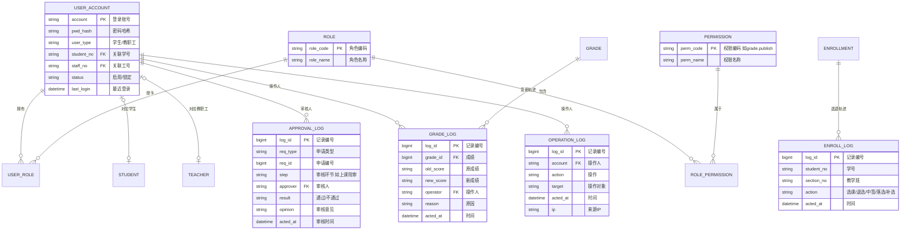

> 审核记录用“申请类型 + 申请编号”指向七类申请单中的任意一类，所以没办法建外键。另一种做法见 §9 第 9 条。

---

## 5. 问题 4：哪些业务需要别的部门支持？——系统边界

```mermaid
flowchart LR
    subgraph 外部["本组范围之外"]
        ZS[招生系统]
        JX[教师信息管理子系统]
        JS[教室管理子系统]
        BS[毕设管理子系统]
        CW[财务系统]
        XX[学信网]
    end
    subgraph 本组["本组范围"]
        XS[学生信息管理]
        KC[课程与选课管理]
        KS[考试管理]
        CJ[成绩管理]
        PJ[评教管理]
    end
    ZS -->|新生名单、身份信息| XS
    JX -->|教师工号、姓名、学院、职称| KC
    JS -->|教室、座位数| KC
    JS -->|考场| KS
    KC -->|排课结果: 教室占用| JS
    KC -->|重修收费名单| CW
    CW -->|缴费结果| KC
    PJ -->|评教结果| JX
    XS -->|学生名单| BS
    CJ -->|成绩| BS
    XS -->|学籍数据| XX
    CJ -->|毕业审核数据| XX
```

| 外部系统 | 外部数据的状态 | 本系统需要的状态 | 差异与处理方式 |
|---|---|---|---|
| 招生系统 | 全部考生的报考、录取信息 | 已报到新生的身份与录取专业 | 入学时**一次性导入**（S06），之后由本系统维护，本系统成为学生数据的主数据源；保留导入批次以便追溯 |
| 教师信息管理 | 教职工全量人事信息 | 工号、姓名、学院、职称 | 建**镜像表**，定期同步（A03），本系统只读；离职教师不删除，标记状态，保证历史教学班仍能关联 |
| 教室管理 | 教室全部属性、借用情况 | 教室编号、楼、校区、座位数、考试座位数 | 建**镜像表**同步；本系统的排课结果反向提供给教室管理，作为教室占用依据（**数据传输接口**） |
| 财务系统 | 收费、缴费流水 | 某条重修报名是否已缴费 | **接口**：推送应收名单，回写“是否缴费” |
| 毕设管理、学信网 | — | 本系统向其提供学生、成绩 | 提供只读视图或导出接口 |

---

## 6. 问题 5：哪些是核心业务，哪些是非核心业务？

对数据库设计的影响：核心业务要不惜成本保证绝对可靠，次要业务可以灵活权衡。这条结论会指导物理设计和性能调优。

| 业务 | 级别 | 理由 | 数据库层面的要求 |
|---|---|---|---|
| 成绩录入、审核、发布、更正 | **核心** | 影响毕业、保研、奖学金，错一分都会出事 | InnoDB 事务、外键与检查约束（比例和 = 100%、分数范围）；成绩变更日志；主从复制 + 定期全量备份 + binlog，可恢复到任意时间点 |
| 选课 | **核心** | 开放瞬间高并发，超选或丢记录会引发大规模投诉 | 容量检查与计数在同一事务；选课日志；高峰期性能保障（§7） |
| 排课、排考 | **核心** | 冲突会导致上不了课、考不了试 | 冲突检测查询要有索引支撑；发布前全量校验 |
| 学籍基本信息 | **核心** | 所有业务的主数据，含敏感信息 | 主键、唯一约束；敏感字段加密；修改必须走申请 + 审核 |
| 评教 | 一般 | 影响教师考核，但不影响学生学业 | 重点在**匿名性**和防重复评价，而不是性能 |
| 培养方案完成情况、统计分析 | 一般 | 由成绩和培养方案计算，可以重算 | 用视图或定时生成的汇总表，允许短时间不一致；可放到从库查询 |
| 课表查询 | 一般 | 由选课和排课派生，学期内基本不变 | 可以缓存 |
| 家庭成员、免听、监考查询 | 非核心 | 低频、影响面小 | 普通表即可 |

---

## 7. 问题 6：不同人群最不希望系统出什么问题？——非功能需求

| 角色 | 最不希望遇到的情况 | 需求类别 | 对数据库设计的影响 |
|---|---|---|---|
| 学生 | 选课开放时卡死，或显示选上了结果被挤掉 | 性能、一致性 | 选课记录（学号、学期）、教学班（课程、学期）建索引；用 `UPDATE section SET enrolled = enrolled + 1 WHERE section_no = ? AND enrolled < capacity` 一类带条件的更新或行锁防止超选；教学班冗余“已选人数”，避免每次 `COUNT(*)` |
| 学生 | 成绩、证件号被别人看到；评教被老师知道是谁写的 | 安全 | 证件号、电话加密存储并脱敏显示；按角色授予视图（§2.3）；教师只能访问评教汇总 |
| 教师 | 成绩录到一半掉线，或截止前系统卡顿 | 可用性、性能 | 暂存与定时自动保存【资料】；录入截止前是写入高峰，成绩表按登记单建索引 |
| 教师 | 自己提交的成绩被人改了 | 安全、可靠 | 提交后只有更正流程能改；成绩变更日志 |
| 管理员 | 排课冲突没被检查出来 | 正确性 | 排课表上按（教室、星期、节次）、（教学班）建索引支撑冲突查询；发布前全量校验 |
| 管理员 | 全校统计跑起来拖垮选课、录成绩 | 性能 | 统计查询走从库（读写分离）；评教、成绩统计用汇总表 |
| 管理员 | 误删数据找不回来 | 可靠 | 核心数据软删除（状态标记）；操作日志；备份策略 |
| 学生、教师 | 管理员权限太大，成绩被人为改动 | 安全 | 管理员对成绩没有直接写权限，只能审批教师的更正申请；所有审核和修改写入审核记录、成绩变更日志 |
| 所有人 | 新校区、小学期、新记分制出现后系统出错 | 可扩展性 | 学期、校区、节次模式、记分制、绩点规则都做成数据而不是写死；为字段预留容量（学分 `DECIMAL(4,2)`、周次位串留 20 周）；历史数据量大后可将已毕业学生的数据归档（库表分离） |

---

## 8. 数据字典

数据类型按 MySQL 写；示例值均为虚构。

| 数据项 | 含义 | 类型 | 取值 / 格式 | 来源 |
|---|---|---|---|---|
| 学号 | 学生唯一标识 | `CHAR(10)` | 10 位数字，前 4 位为入学年份，例 `2024211001` | 实测 |
| 工号 | 教职工唯一标识 | `VARCHAR(20)` | 格式待确认 | 推断 |
| 姓名 | | `VARCHAR(50)` | 需支持少数民族长姓名 | |
| 性别 | | `ENUM` | 男 / 女 / 未说明的性别 | 实测 |
| 证件号 | | `VARBINARY(64)` | 加密存储，明文 18 位 | 实测 |
| 民族 | | `CHAR(2)` | 国家标准民族代码，显示时转名称 | 实测 |
| 政治面貌 | | `CHAR(2)` | 中共党员、中共预备党员、共青团员、各民主党派、无党派民主人士、群众 | 实测 |
| 学籍状态 | | `VARCHAR(10)` | 在读 / 休学 / 退学 / 毕业 / 结业 | 推断 |
| 班级号 | 行政班标识 | `CHAR(10)` | 10 位数字，例 `2024211301` | 实测 |
| 学院代码 | | `VARCHAR(10)` | 例 `202000` | 实测 |
| 学年学期 | | `CHAR(11)` | `YYYY-YYYY-N`，N ∈ {1, 2, 3}，3 为小学期 | 实测 |
| 课程编号 | | `CHAR(10)` | 10 位数字 | 实测 |
| 学分 | | `DECIMAL(4,2)` | 实测有 0.4、0.5、1、2、3 | 实测 |
| 学时 | | `SMALLINT` | 总学时 = 讲课 + 实践 + 讲座 + 实验 + 课外 | 实测 |
| 考核方式 | | `ENUM` | 考试 / 考查 | 实测 |
| 课程性质 | | `VARCHAR(20)` | 思想政治理论课、公共课、专业课、实践教学课、校级双创课、院级双创课、其他 | 实测 |
| 课程属性 | 对某专业的修读要求 | `VARCHAR(10)` | 必修 / 选修 / 任选 | 实测 |
| 开课编号 | 教学班标识 | `VARCHAR(32)` | 格式待确认 | 实测 |
| 教学班状态 | | `VARCHAR(10)` | 计划中 / 已安排教师 / 已排课 / 选课中 / 已开课 / 已结课 / 已停开 | 推断 |
| 周次 | | `CHAR(20)` | 位串，第 i 位为 1 表示第 i 周上课；显示为“第 3-11,13,15-18 周” | 实测 |
| 星期 | | `TINYINT` | 1–7 | 实测 |
| 节次 | | `TINYINT` | 1–14；第 1 节 08:00–08:45 …… 第 14 节 20:10–20:55 | 实测 |
| 校区 / 节次模式 | | `VARCHAR(10)` | 校本部 / 沙河校区 / 海南校区 | 实测 |
| 调课类型 | | `VARCHAR(10)` | 整体调课 / 部分调课 / 停课 / 变更教师 | 资料 |
| 选课模式 | | `VARCHAR(10)` | 抽签 / 即选即得 | 资料 |
| 选课状态 | | `VARCHAR(10)` | 已预选 / 已选中 / 未中签 / 已退选 / 已修读 | 推断 |
| 修读类型 | | `VARCHAR(10)` | 首修 / 重修 / 补修 | 实测 |
| 学期类别 | 考试批次 | `TINYINT` | 1 期初、2 期中、3 期末 | 实测编码 |
| 考试性质 | | `VARCHAR(10)` | 正考 / 补考 / 缓考 | 推断 |
| 座位号 | | `SMALLINT` | | 实测 |
| 准考证号 | | `VARCHAR(20)` | | 实测 |
| 监考角色 | | `VARCHAR(10)` | 主监考 / 监考 | 推断 |
| 记分制 | | `VARCHAR(10)` | 百分制 / 五级制 / 二级制 | 实测（有百分制和“优”） + 推断 |
| 成绩分项 | | `VARCHAR(20)` | 平时 / 期中 / 期末 / 实验等 | 资料 |
| 分项比例 | | `DECIMAL(5,2)` | 0–100，同一登记单内之和 = 100 | 资料 |
| 成绩登记单状态 | | `VARCHAR(10)` | 未录入 / 录入中 / 已提交 / 已发布 | 资料 + 推断 |
| 总评（显示值） | | `VARCHAR(10)` | 百分制数字或等级，例 89、优 | 实测 |
| 总评（折算分） | | `DECIMAL(5,2)` | 0–100，等级制按规则折算 | 推断 |
| 成绩标识 | | `VARCHAR(10)` | 违纪 / 缺考 / 舞弊 / 取消考试资格；正常为空 | 资料 |
| 绩点 | | `DECIMAL(3,2)` | 0–4，例 3.77 | 实测 |
| 审核状态 | 申请单状态 | `TINYINT` | 3 待审、2 审核中、1 通过、0 不通过 | 实测编码 |
| 评价分类 | | `VARCHAR(20)` | 例：理论课评价、实验课评价 | 实测（字段） + 推断（取值） |
| 指标得分 | | `DECIMAL(5,2)` | 0–指标满分 | 推断 |
| 评教批次状态 | | `VARCHAR(10)` | 未开始 / 进行中 / 已结束 / 已汇总 | 推断 |
| 用户类型 | | `VARCHAR(10)` | 学生 / 教职工 | 推断 |
| 角色编码 | | `VARCHAR(20)` | student / teacher / admin | 推断 |

---

## 9. 对后续数据库设计的启示

评分标准要求“有限的反范式操作应该是权衡后的有意识行为”。下面标 ⚖ 的是需要在设计文档里写清楚权衡的地方。

1. **“上课时间”不满足 1NF。** 现有系统显示为“第 3-11,13,15-18 周 1[03-04]节”，要拆成排课表。⚖ 周次可以每周一行（规范，但冲突检测要大量连接），也可以存成 20 位位串（冲突检测只需按位与）。
2. **学期要独立成表**：历史上出现过“-3”小学期。
3. **课程和教学班分开**：课程是目录，教学班是某学期具体的班；课表、选课、考试、成绩、评教都挂在教学班上。
4. **课程属性属于“培养方案 × 课程”联系**，不属于课程本身。
5. ⚖ **同一门课可以有多条成绩**（正考、补考、重修）。“最好成绩”由查询算出，还是在成绩上加标志位，要权衡。
6. ⚖ **绩点**由规则换算，查询频繁而规则很少变，可以冗余存储；规则变化时需要批量重算。
7. ⚖ **成绩上冗余存学分**作为快照：培养方案修订后学分可能变，但历史成绩要按当时的学分计算。
8. ⚖ **教学班上的“已选人数”是冗余计数**：可以由选课记录 `COUNT` 得到，但选课高峰期每次都数代价太大。
9. **申请单是否统一。** 本系统有七类申请，状态机相同。可以抽出“申请单”父表（类型、申请人、状态、时间）+ 各类型明细子表，审核记录就能用外键指向父表；也可以各建各的表，审核记录用“类型 + 编号”软关联。前者便于统一审核和统计，后者结构直观。
10. **成绩状态放在登记单上**，以教学班为单位提交和审核，而不是每条成绩各自一个状态。这和教师“按班提交”、管理员“按班审核”的实际操作一致。
11. ⚖ **评教的匿名性。** 评价记录必须存学号，否则无法防止重复评价、无法统计参评率；但教师端只能访问汇总表。更严格的做法是只存学号的哈希，代价是无法追查恶意评价。
12. ⚖ **评教结果汇总表**是反范式快照：批次结束后数据不再变化，用汇总表避免每次查询都聚合全校评价记录。
13. **教师、教室是镜像表**：只保留本系统需要的字段，标注数据来源和同步时间；离职教师、停用教室只改状态不删除。
14. **检查约束**：成绩分项比例之和 = 100%、分数在 0–100、选课不超容量。MySQL 8.0.16 以上支持 `CHECK`；跨行的约束（比例之和）需要触发器或存储过程。

---

## 10. 待确认问题（需求检查点上问老师）

1. **评教管理**：本组把评教放进了范围（毕设、教室、教师信息不做）。是否合适？
2. **管理员合并**：本组把学院教务、教务处、系统管理员合并成一个“管理员”角色，多级审核（如重修的两级院审）简化为一次审核。这样简化可以吗？
3. **选课模式**：只做“即选即得”，还是同时支持“抽签”？两者的选课记录状态不同（§4.8）。
4. **评教与成绩的关联**：是否要求“完成评教后才能查看成绩”？如果要，查询成绩时需要关联评价记录。
5. **学籍异动**：由管理员直接办理即可，还是需要学生在线申请？
6. **教师、教室镜像表**：字段只保留本系统需要的，是否可以？

---

## 附录 A：资料来源

- 北京邮电大学本科教务系统学生端，2026-11-03 实测，记录见 `01-学生端业务调研与需求分析.md`。
- 齐鲁工业大学《教师端成绩报送操作手册》（强智教务系统）：成绩录入时间窗、成绩分项比例、Excel 导入、成绩标识取值、提交后打印。<https://ysxy.qlu.edu.cn/_upload/article/files/ed/a9/ca41c23449508b16dd3c617dbbdb/28a00259-af6e-4fd6-936e-0f18e48ffd42.pdf>
- 西北师范大学《教师调课申请操作手册》（jsxsd）：调课方式与类型、可用时间与地点的冲突检测、送审与撤回。<https://jwc.nwnu.edu.cn/_upload/article/files/02/5d/2a29042a4f14a7c220543cfa6e8f/0244f863-249b-49bc-a55f-4209e8a52d8c.pdf>
- 北京理工大学《成绩录入操作说明》：录入状态（未录入 / 录入中 / 已确认）、成绩构成计算公式、部分提交。<https://jxzx.bit.edu.cn/docs/2025-05/87c79e1c606a4b32b1fce30203599c50.pdf>
- 强智科技教学信息一体化平台介绍：图形化排课、抽签 / 即选即得选课模式、一键排考。<https://tech.ifeng.com/c/8LaNHR3q7qj>
